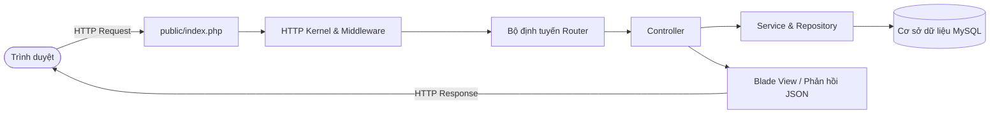
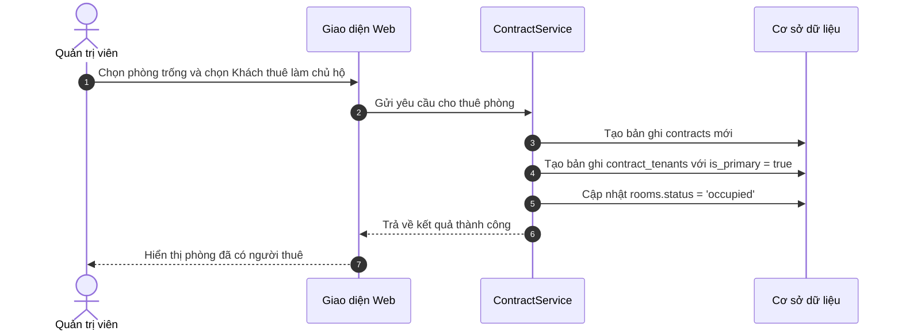
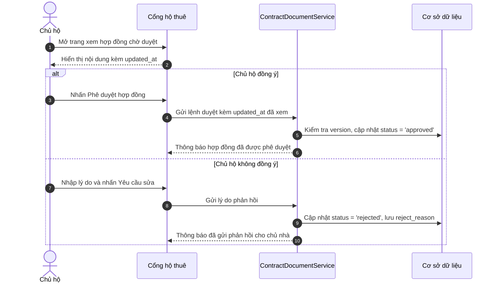
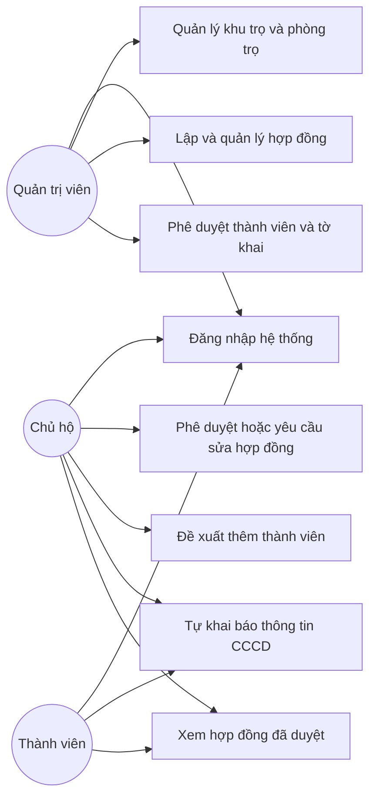
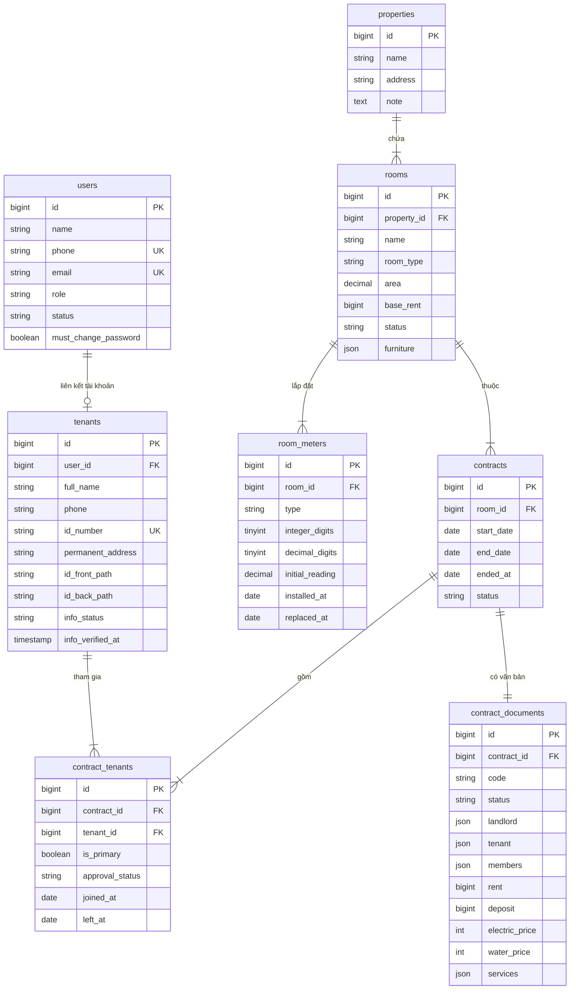
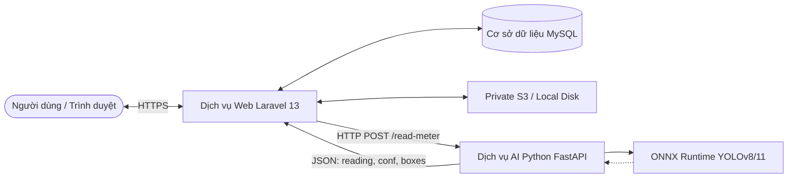
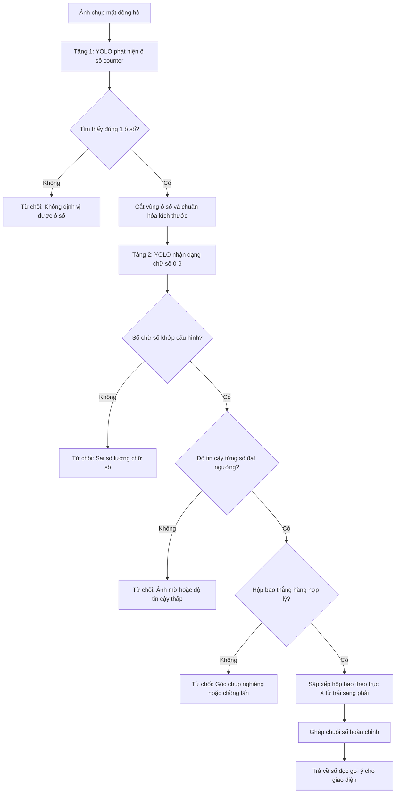
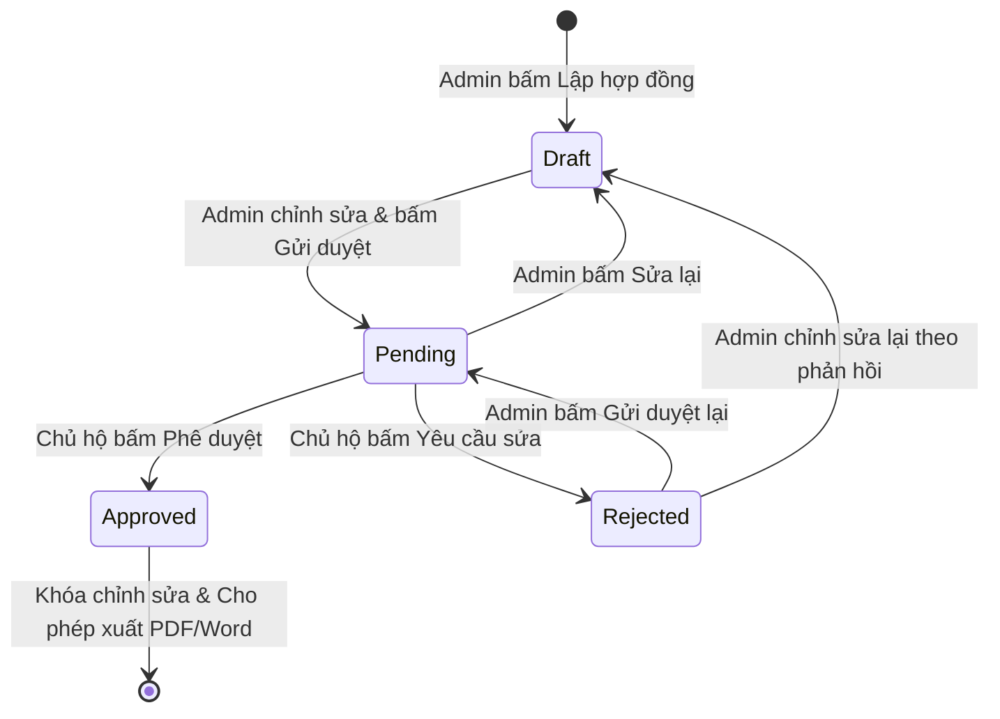

# TRƯỜNG ĐẠI HỌC KIẾN TRÚC HÀ NỘI
## KHOA CÔNG NGHỆ THÔNG TIN

---

# BÁO CÁO TIẾN ĐỘ ĐỒ ÁN TỐT NGHIỆP
### MỐC ĐÁNH GIÁ HOÀN THÀNH TUẦN THỨ 6

**Đề tài:**  
# XÂY DỰNG HỆ THỐNG QUẢN LÝ NHÀ CHO THUÊ SỬ DỤNG FRAMEWORK LARAVEL TÍCH HỢP NHẬN DẠNG CHỈ SỐ ĐIỆN NƯỚC TỪ ẢNH CHỤP BẰNG MÔ HÌNH YOLO

Giảng viên hướng dẫn: PGS.TS. Nguyễn Chấn Hùng  
Sinh viên thực hiện: Phạm Hữu Ngọc  
Lớp: 22CN1  
Ngành: Công nghệ thông tin  
Thời gian thực hiện kế hoạch: 15 tuần (Từ 05/10/2026 đến 18/01/2027)

*Hà Nội, tháng 11 năm 2026*

---

# LỜI CẢM ƠN

Lời đầu tiên, em xin bày tỏ lòng biết ơn sâu sắc tới Ban Giám hiệu Trường Đại học Kiến trúc Hà Nội cùng các thầy cô giáo Khoa Công nghệ thông tin đã tận tình giảng dạy và trang bị cho em nền tảng kiến thức chuyên môn vững chắc.

Đặc biệt, em xin gửi lời cảm ơn chân thành nhất tới thầy giáo hướng dẫn – PGS.TS. Nguyễn Chấn Hùng. Thầy đã luôn định hướng, tận tình chỉ dẫn và đóng góp nhiều ý kiến chuyên môn quý báu giúp em hoàn thành tốt các mục tiêu đề ra trong 6 tuần đầu tiên của đồ án tốt nghiệp.

Dù đã rất nỗ lực, báo cáo tiến độ tuần thứ 6 khó tránh khỏi những thiếu sót nhất định. Em rất mong tiếp tục nhận được những nhận xét, góp ý từ thầy để hoàn thiện hệ thống tốt hơn trong các giai đoạn tiếp theo.

Sinh viên thực hiện  
**Phạm Hữu Ngọc**

---

# MỤC LỤC

LỜI CẢM ƠN  
DANH MỤC CÁC BẢNG BIỂU  
DANH MỤC HÌNH ẢNH  
DANH MỤC CÁC KÝ HIỆU VÀ CHỮ VIẾT TẮT  
MỞ ĐẦU  
CHƯƠNG 1. TỔNG QUAN VÀ CƠ SỞ LÝ THUYẾT  
1.1. Khảo sát nghiệp vụ quản lý nhà cho thuê  
1.1.1. Hiện trạng quản lý nhà trọ  
1.1.2. Quy trình một kỳ thuê phòng  
1.1.3. Khảo sát một số phần mềm hiện có  
1.2. Framework Laravel và công nghệ web  
1.2.1. Mô hình MVC và vòng đời request trong Laravel  
1.2.2. Quản lý dữ liệu với Eloquent ORM, Migration và Seeder  
1.2.3. Xác thực và phân quyền người dùng  
1.2.4. Xây dựng giao diện với Blade, Tailwind CSS và Vite  
1.2.5. Hệ quản trị cơ sở dữ liệu MySQL  
1.2.6. Xuất văn bản bằng mPDF và HTML tương thích Word .doc  
1.3. Bài toán tự động đọc chỉ số đồng hồ điện nước  
1.3.1. Đặc điểm các loại đồng hồ đo và ảnh chụp  
1.3.2. Các hướng tiếp cận nhận dạng chỉ số  
1.4. Mô hình YOLO  
1.4.1. Bài toán phát hiện đối tượng  
1.4.2. Kiến trúc các phiên bản YOLOv8 và YOLO11  
1.4.3. Các chỉ số đánh giá Precision, Recall và mAP  
1.5. Các bộ dữ liệu công khai và giấy phép sử dụng  
1.6. Công nghệ xây dựng dịch vụ nhận dạng với Python và FastAPI  
CHƯƠNG 2. PHÂN TÍCH VÀ THIẾT KẾ HỆ THỐNG  
2.1. Yêu cầu hệ thống  
2.1.1. Các nhóm tác nhân người dùng  
2.1.2. Yêu cầu chức năng cho tám module  
2.1.3. Yêu cầu phi chức năng  
2.2. Sơ đồ chức năng  
2.2.1. Sơ đồ phân cấp chức năng  
2.2.2. Sơ đồ luồng nghiệp vụ cốt lõi  
2.3. Thiết kế Use Case  
2.3.1. Sơ đồ Use Case tổng quát  
2.3.2. Sơ đồ Use Case phân rã  
2.3.3. Đặc tả các Use Case chính  
2.4. Thiết kế cơ sở dữ liệu  
2.4.1. Sơ đồ thực thể liên kết ERD  
2.4.2. Cấu trúc chi tiết các bảng dữ liệu đã xây dựng  
2.4.3. Định hướng mở rộng cơ sở dữ liệu cho phân hệ tài chính  
2.5. Thiết kế kiến trúc hệ thống  
2.5.1. Kiến trúc tổng thể hai service Laravel và Python  
2.5.2. Kiến trúc phân tầng mã nguồn trong Laravel  
2.5.3. Thiết kế pipeline nhận dạng hai tầng và cơ chế từ chối đọc  
2.5.4. Ràng buộc an toàn giữa số gợi ý và số xác nhận  
2.6. Thiết kế giao diện web và tối ưu trên di động  
CHƯƠNG 3. XÂY DỰNG HỆ THỐNG QUẢN LÝ NHÀ CHO THUÊ  
3.1. Môi trường và công cụ phát triển  
3.2. Cấu trúc mã nguồn dự án  
3.3. Phân hệ đăng nhập và phân quyền  
3.3.1. Đăng nhập an toàn và giới hạn số lần thử  
3.3.2. Phân quyền truy cập cho ba vai trò  
3.3.3. Mật khẩu tạm và bắt buộc đổi mật khẩu lần đầu  
3.3.4. Quản trị tài khoản người dùng  
3.4. Module Nhà và phòng  
3.4.1. Quản lý danh mục khu trọ  
3.4.2. Danh sách phòng và bộ lọc trạng thái  
3.4.3. Chi tiết phòng và checklist nội thất bàn giao  
3.4.4. Cấu hình đồng hồ đo và lưu lịch sử thay đồng hồ  
3.5. Module Khách thuê  
3.5.1. Hồ sơ khách thuê và bảo mật ảnh căn cước công dân  
3.5.2. Nghiệp vụ thuê phòng, cấp tài khoản và trả phòng  
3.5.3. Cổng hộ thuê thêm người ở cùng và tự khai báo thông tin  
3.5.4. Phê duyệt thành viên và duyệt thông tin tự khai báo  
3.6. Module Hợp đồng thuê  
3.6.1. Tự động lập văn bản hợp đồng từ hồ sơ  
3.6.2. Quản lý vòng đời hợp đồng và kiểm soát xung đột  
3.6.3. Chủ hộ phê duyệt hoặc yêu cầu sửa hợp đồng  
3.6.4. Xuất hợp đồng ra PDF và HTML tương thích Word .doc  
3.7. Bảng điều khiển theo dõi tỷ lệ lấp phòng và việc chờ duyệt  
3.8. Triển khai hệ thống lên máy chủ VPS  
CHƯƠNG 4. KẾT QUẢ ĐẠT ĐƯỢC VÀ KẾ HOẠCH TIẾP THEO  
4.1. Kết quả thực hiện đến hết tuần 6  
4.1.1. Đối chiếu tiến độ với kế hoạch được duyệt  
4.1.2. Bảng tổng hợp các chức năng đã hoàn thành  
4.1.3. Kết quả kiểm thử chức năng các module đã làm  
4.1.4. Giao diện minh hoạ hệ thống thực tế  
4.2. Khó khăn gặp phải và giải pháp xử lý  
4.3. Kế hoạch triển khai từ tuần 7 đến tuần 15  
4.3.1. Tuần 7 và 8 hoàn thiện các module nghiệp vụ còn lại  
4.3.2. Tuần 9 đến 11 chuẩn bị dữ liệu và huấn luyện mô hình YOLO  
4.3.3. Tuần 12 và 13 tích hợp mô hình và đánh giá thực nghiệm  
4.3.4. Tuần 14 và 15 hoàn thiện báo cáo, slide và video demo  
KẾT LUẬN  
TÀI LIỆU THAM KHẢO  
PHỤ LỤC  
Phụ lục 1. Danh sách chức năng và đường dẫn route của hệ thống  
Phụ lục 2. Hướng dẫn cài đặt và vận hành hệ thống  
Phụ lục 3. Cấu trúc chi tiết cơ sở dữ liệu  
Phụ lục 4. Trích lục nội dung văn bản hợp đồng thuê phòng theo mẫu hiển thị của hệ thống  

---

# DANH MỤC CÁC BẢNG BIỂU

Bảng 2.1. Ma trận phân quyền chức năng cho ba nhóm tác nhân người dùng  
Bảng 2.2. Danh mục các trường dữ liệu bảng tài khoản người dùng users  
Bảng 2.3. Danh mục các trường dữ liệu bảng khu trọ properties  
Bảng 2.4. Danh mục các trường dữ liệu bảng phòng trọ rooms  
Bảng 2.5. Danh mục các trường dữ liệu bảng đồng hồ đo điện nước room_meters  
Bảng 2.6. Danh mục các trường dữ liệu bảng hồ sơ khách thuê tenants  
Bảng 2.7. Danh mục các trường dữ liệu bảng hợp đồng thuê contracts  
Bảng 2.8. Danh mục các trường dữ liệu bảng quan hệ người thuê và hợp đồng contract_tenants  
Bảng 2.9. Danh mục các trường dữ liệu bảng văn bản hợp đồng pháp lý contract_documents  
Bảng 4.1. Đối chiếu tiến độ thực tế với kế hoạch 15 tuần đã được phê duyệt  
Bảng 4.2. Tổng hợp trạng thái các chức năng nghiệp vụ hoàn thành sau 6 tuần  
Bảng 4.3. Kết quả thực thi các ca kiểm thử chức năng trên các module đã hoàn thiện  

---

# DANH MỤC HÌNH ẢNH

Hình 1.1. Sơ đồ vòng đời xử lý yêu cầu HTTP trong framework Laravel  
Hình 2.1. Sơ đồ phân cấp cấu trúc chức năng của toàn hệ thống  
Hình 2.2. Sơ đồ tuần tự quy trình cho thuê phòng và tạo lập hợp đồng  
Hình 2.3. Sơ đồ tuần tự quy trình chủ hộ duyệt hoặc yêu cầu chỉnh sửa hợp đồng  
Hình 2.4. Sơ đồ ca sử dụng tổng quát của hệ thống  
Hình 2.5. Sơ đồ thực thể liên kết ERD giữa các bảng dữ liệu  
Hình 2.6. Sơ đồ kiến trúc tổng thể giao tiếp giữa dịch vụ Laravel và dịch vụ Python  
Hình 2.7. Sơ đồ đường ống nhận dạng hai tầng và bốn chốt chặn từ chối đọc  
Hình 3.1. Sơ đồ chuyển đổi trạng thái của văn bản hợp đồng điện tử  

---

# DANH MỤC CÁC KÝ HIỆU VÀ CHỮ VIẾT TẮT

| Chữ viết tắt | Cụm từ tiếng Anh / Tiếng Việt đầy đủ | Ý nghĩa giải thích |
| :--- | :--- | :--- |
| **AMR** | Automatic Meter Reading | Hệ thống đọc chỉ số đồng hồ tự động |
| **API** | Application Programming Interface | Giao diện lập trình ứng dụng |
| **CCCD** | Căn cước công dân | Giấy tờ tùy thân định danh công dân |
| **CRUD** | Create, Read, Update, Delete | Bốn thao tác dữ liệu cơ bản: Thêm, Đọc, Sửa, Xóa |
| **CSS** | Cascading Style Sheets | Ngôn ngữ định dạng trang web |
| **ERD** | Entity Relationship Diagram | Sơ đồ quan hệ thực thể |
| **FastAPI** | FastAPI Web Framework | Framework phát triển web hiệu năng cao bằng Python |
| **HTML** | HyperText Markup Language | Ngôn ngữ đánh dấu siêu văn bản |
| **HTTP** | HyperText Transfer Protocol | Giao thức truyền tải siêu văn bản |
| **IoU** | Intersection over Union | Tỷ lệ phần giao trên phần hợp giữa hai khung hình |
| **mAP** | Mean Average Precision | Độ chính xác trung bình của mô hình phát hiện đối tượng |
| **mPDF** | mPDF Library | Thư viện PHP chuyển đổi mã nguồn HTML sang tệp tài liệu PDF |
| **MVC** | Model - View - Controller | Mô hình kiến trúc phần mềm tách biệt Dữ liệu, Giao diện và Điều khiển |
| **OCR** | Optical Character Recognition | Công nghệ nhận dạng ký tự quang học |
| **ONNX** | Open Neural Network Exchange | Chuẩn mở trao đổi và tối ưu hóa mô hình học sâu |
| **ORM** | Object-Relational Mapping | Kỹ thuật ánh xạ đối tượng với cơ sở dữ liệu quan hệ |
| **PDF** | Portable Document Format | Định dạng tài liệu số di động |
| **REST** | Representational State Transfer | Kiểu kiến trúc truyền tải trạng thái đại diện |
| **S3** | Simple Storage Service | Dịch vụ lưu trữ đối tượng đám mây |
| **UI/UX** | User Interface / User Experience | Giao diện người dùng và Trải nghiệm người dùng |
| **VPS** | Virtual Private Server | Máy chủ ảo dùng riêng |
| **YOLO** | You Only Look Once | Mô hình phát hiện đối tượng thời gian thực sử dụng mạng nơ ron |

---

# MỞ ĐẦU

Trong bối cảnh đô thị hóa nhanh chóng tại các đô thị lớn, nhu cầu thuê trọ và căn hộ dịch vụ ngày càng gia tăng, kéo theo sự phức tạp trong công tác quản lý vận hành. Phần lớn các chủ nhà trọ hiện nay vẫn duy trì phương thức quản lý thủ công bằng sổ sách hoặc bảng tính phân mảnh, dễ dẫn đến thất lạc hồ sơ cư trú, thiếu minh bạch trong giao kết hợp đồng và tốn nhiều công sức khi chốt chỉ số điện nước hàng tháng. Việc đọc và ghi chép chỉ số thủ công không chỉ tiềm ẩn nguy cơ sai sót gây tranh chấp hóa đơn, mà còn thiếu hình ảnh lưu vết làm căn cứ đối soát tin cậy. Xuất phát từ nhu cầu thực tiễn đó, đề tài **"Xây dựng hệ thống quản lý nhà cho thuê sử dụng framework Laravel tích hợp nhận dạng chỉ số điện nước từ ảnh chụp bằng mô hình YOLO"** được lựa chọn nghiên cứu nhằm số hóa toàn diện quy trình vận hành, nâng cao tính minh bạch và tối ưu hóa hiệu suất quản trị.

Mục tiêu cốt lõi của đề tài là xây dựng một hệ thống phần mềm web hoàn chỉnh trên nền tảng framework Laravel 13, chuẩn hóa chu kỳ nghiệp vụ quản lý nhà trọ qua tám phân hệ chức năng: Nhà và phòng, Khách thuê, Hợp đồng, Chốt chỉ số, Hóa đơn, Thu tiền và công nợ, Nhắc tự động cùng Báo cáo thống kê. Song song với đó, đề tài tập trung nghiên cứu, huấn luyện và tích hợp mô hình học sâu YOLO hai tầng gồm khoanh vùng ô số hiển thị và nhận dạng từng ký tự số, được đóng gói dưới dạng dịch vụ nhận dạng riêng bằng Python FastAPI. Thông qua cơ chế bốn chốt chặn từ chối đọc tự động đối với ảnh chụp kém chất lượng, hệ thống hướng tới việc giảm thiểu thao tác nhập liệu thủ công của chủ nhà, hạn chế nguy cơ sai lệch khi tính toán hóa đơn và cung cấp kênh tương tác trực tuyến hai chiều minh bạch giữa chủ trọ và khách thuê.

Đối tượng nghiên cứu chính của đề tài bao gồm quy trình nghiệp vụ quản lý nhà cho thuê, kiến trúc ứng dụng web đa tầng với framework Laravel 13, hệ quản trị cơ sở dữ liệu MySQL, cùng các kỹ thuật thị giác máy tính và học sâu dựa trên kiến trúc mạng YOLO [2], [4]. Về mặt phạm vi, hệ thống tập trung giải quyết bài toán quản lý cho mô hình chủ nhà sở hữu nhiều khu trọ và phòng trọ độc lập với ba vai trò người dùng rõ rệt: Quản trị viên (Chủ nhà), Chủ hộ thuê phòng và Thành viên ở cùng. Tại mốc đánh giá hoàn thành tuần thứ 6 trên kế hoạch 15 tuần đã được Khoa Công nghệ thông tin phê duyệt, phạm vi báo cáo tập trung tổng kết các kết quả khảo sát nghiệp vụ, hoàn thiện thiết kế cơ sở dữ liệu nền tảng, thiết lập cơ chế phân quyền bảo mật, cùng việc hiện thực hóa và kiểm thử thành công ba phân hệ cốt lõi: Quản lý nhà và phòng, Quản lý khách thuê và Quản lý văn bản hợp đồng điện tử.

Để đạt được các mục tiêu đề ra, đề tài áp dụng kết hợp phương pháp nghiên cứu lý thuyết và phương pháp thực nghiệm công nghệ. Về mặt lý thuyết, đồ án tổng hợp các tài liệu chuyên ngành về kiến trúc phân tầng Controller - Service - Repository [5], lý thuyết mạng nơ-ron tích chập phát hiện đối tượng YOLO [2], cơ chế tối ưu hóa suy luận mô hình qua chuẩn ONNX và các nguyên tắc bảo mật phần mềm web. Về mặt thực nghiệm, đồ án triển khai xây dựng cấu trúc cơ sở dữ liệu quan hệ thông qua Migration, hiện thực hóa các lớp xử lý nghiệp vụ độc lập, thiết kế giao diện đáp ứng với Blade và Tailwind CSS, cấu hình kịch bản tự động hóa triển khai trên máy chủ VPS với ổ đĩa lưu trữ riêng tư, đồng thời thực thi các ca kiểm thử chức năng nhằm bước đầu xác nhận tính ổn định của hệ thống.

Ngoài các nội dung mở đầu, danh mục bổ trợ, kết luận, tài liệu tham khảo và phụ lục kỹ thuật, phần thân của Báo cáo tiến độ tuần thứ 6 được cấu trúc thành bốn chương mạch lạc. Chương 1 trình bày tổng quan khảo sát nghiệp vụ nhà trọ, cơ sở lý thuyết về framework Laravel 13, bài toán đọc chỉ số tự động và mô hình YOLO. Chương 2 đi sâu vào phân tích yêu cầu hệ thống, xây dựng sơ đồ phân cấp chức năng, sơ đồ Use Case, thiết kế cơ sở dữ liệu quan hệ và kiến trúc hai dịch vụ tích hợp. Chương 3 là phần trọng tâm trình bày kết quả hiện thực hóa mã nguồn, giao diện và các luồng xử lý thực tế của ba phân hệ nghiệp vụ đã hoàn thành cùng quy trình triển khai máy chủ VPS. Chương 4 tổng hợp đối chiếu tiến độ thực tế với kế hoạch 15 tuần đã ký kết, trình bày số liệu kiểm thử chức năng và xây dựng lộ trình thực hiện chi tiết cho giai đoạn từ tuần 7 đến tuần 15.

---

# CHƯƠNG 1. TỔNG QUAN VÀ CƠ SỞ LÝ THUYẾT

### 1.1. Khảo sát nghiệp vụ quản lý nhà cho thuê

#### 1.1.1. Hiện trạng quản lý nhà trọ
Tại các thành phố lớn, mô hình nhà trọ cho thuê rất đa dạng, từ các dãy phòng trọ cấp bốn, nhà nguyên căn chia phòng đến các tòa chung cư mini từ 10 đến 40 phòng do các hộ gia đình tự quản lý. 

Phần lớn chủ nhà trọ quản lý việc thu chi và thông tin người thuê qua ghi chép tay hoặc các bảng tính Excel đơn giản. Phương thức này có ưu điểm là dễ tiếp cận nhưng bộc lộ nhiều điểm hạn chế khi quy mô phòng tăng lên: hồ sơ khách thuê lưu trữ phân tán; khó theo dõi tình trạng hợp đồng; việc sao chép số đo điện nước thủ công từ đồng hồ vào sổ sách dễ gây nhầm lẫn chữ số, dẫn đến tranh chấp khi tính tiền hàng tháng.

#### 1.1.2. Quy trình một kỳ thuê phòng
Nghiệp vụ quản lý nhà trọ vận hành lặp lại theo chu kỳ khép kín hàng tháng với năm giai đoạn kế tiếp nhau. Giai đoạn đầu kỳ thuê diễn ra khi khách chuyển vào ở: hai bên ký kết hợp đồng, ghi nhận thông tin tùy thân, tiền đặt cọc bảo đảm, thỏa thuận đơn giá điện nước, các khoản phí dịch vụ cố định và lập biên bản bàn giao hiện trạng trang thiết bị nội thất trong phòng. Đến cuối mỗi kỳ thanh toán, người quản lý tiến hành chốt chỉ số điện nước trên đồng hồ để xác định khối lượng sử dụng trong tháng dựa trên chênh lệch với số đo kỳ trước. Trên cơ sở đó, hệ thống lập hóa đơn tổng hợp gồm tiền thuê phòng, tiền điện nước thực tế và các loại phí phát sinh. Khâu tiếp theo là thu tiền và theo dõi công nợ, hỗ trợ thanh toán một lần hoặc chia nhỏ theo từng đợt, ghi nhận số dư nợ và gửi cảnh báo khi quá hạn. Cuối cùng, khi kết thúc kỳ thuê hoặc chấm dứt hợp đồng, hai bên cùng đối chiếu lại hiện trạng nội thất, khấu trừ công nợ tồn đọng hoặc chi phí hư hại tài sản vào tiền đặt cọc trước khi hoàn trả số dư còn lại cho khách thuê.

#### 1.1.3. Khảo sát một số phần mềm hiện có
Hiện nay trên thị trường đã có một số ứng dụng và nền tảng hỗ trợ quản lý nhà trọ. Đa số các giải pháp này cung cấp các tính năng quản lý danh sách phòng, theo dõi hợp đồng và hỗ trợ tính tiền phòng định kỳ. 

Tuy nhiên, phần lớn các ứng dụng phổ biến yêu cầu người dùng trả phí thuê bao định kỳ, nhiều tính năng nâng cao không thực sự cần thiết cho các chủ trọ cá thể. Đặc biệt, ở khâu thu thập chỉ số điện nước, đa số phần mềm vẫn yêu cầu người quản lý phải đọc chỉ số bằng mắt rồi nhập tay từng số vào ứng dụng. Khách thuê cũng ít khi có một giao diện riêng để chủ động xem xét dự thảo hợp đồng hoặc tự khai báo thông tin cá nhân của các thành viên ở cùng phòng.

### 1.2. Framework Laravel và công nghệ web

#### 1.2.1. Mô hình MVC và vòng đời request trong Laravel
Laravel [1] là framework mã nguồn mở dành cho ngôn ngữ PHP, được xây dựng theo mô hình kiến trúc MVC (Model - View - Controller), mang lại cấu trúc mã nguồn sáng rõ và khả năng mở rộng tốt.


*Hình 1.1. Sơ đồ vòng đời xử lý yêu cầu HTTP trong framework Laravel*

Vòng đời xử lý một yêu cầu HTTP trong Laravel diễn ra tuần tự: yêu cầu từ người dùng gửi tới tệp `public/index.php`, đi qua HTTP Kernel và chuỗi các Middleware để kiểm tra bảo mật (bảo vệ CSRF, xác thực đăng nhập, phân quyền). Tiếp đó, bộ định tuyến Router điều hướng yêu cầu tới Controller tương ứng. Controller tương tác với các tầng nghiệp vụ (Service, Repository) để truy xuất dữ liệu từ Model, sau đó trả về phản hồi dưới dạng giao diện Blade hoặc chuỗi dữ liệu JSON.

#### 1.2.2. Quản lý dữ liệu với Eloquent ORM, Migration và Seeder
Trong hệ sinh thái Laravel, công cụ Eloquent ORM cung cấp cơ chế ánh xạ đối tượng với cơ sở dữ liệu quan hệ thuận tiện và hiệu quả, cho phép lập trình viên thao tác với các bảng dữ liệu dưới dạng các lớp Model hướng đối tượng, dễ dàng thiết lập các mối quan hệ và hỗ trợ kỹ thuật nạp dữ liệu liên quan (Eager Loading) nhằm giảm bớt số lượng truy vấn cơ sở dữ liệu dư thừa.

Bên cạnh ORM, hệ thống Migration đóng vai trò như một công cụ quản lý phiên bản cho cơ sở dữ liệu. Toàn bộ cấu trúc bảng, kiểu dữ liệu, các ràng buộc chỉ mục và giá trị mặc định đều được định nghĩa hoàn toàn bằng mã nguồn PHP, đảm bảo môi trường dữ liệu giữa máy trạm phát triển và máy chủ vận hành luôn được đồng bộ nhất quán. Đi kèm với đó, cơ chế Seeder cho phép tự động khởi tạo các bộ dữ liệu mẫu phục vụ phát triển, thử nghiệm tính năng và thiết lập sẵn tài khoản quản trị hệ thống ban đầu.

#### 1.2.3. Xác thực và phân quyền người dùng
Laravel cung cấp sẵn hệ thống xác thực an toàn dựa trên thuật toán băm mật khẩu Bcrypt kết hợp bảo vệ phiên làm việc. Nhằm kiểm soát chặt chẽ quyền hạn của từng nhóm đối tượng người dùng, dự án kết hợp đồng thời hai cơ chế Middleware và Gate. Tại tầng định tuyến mạng, các lớp Middleware đảm nhiệm vai trò chốt chặn đầu tiên, lập tức từ chối hoặc điều hướng các yêu cầu HTTP trái phép trước khi tiếp cận tới bộ điều khiển. Trong khi đó, tại tầng xử lý nghiệp vụ sâu hơn, các Gate được sử dụng để đóng gói các quy tắc phân quyền cụ thể như quyền quản lý nhà trọ `manage-rental` dành cho chủ nhà hay quyền điều hành hộ thuê `manage-household` dành cho chủ hộ. Việc phân quyền dựa trên khả năng hành động thay vì kiểm tra tên vai trò cứng nhắc giúp mã nguồn đạt tính linh hoạt cao và dễ dàng mở rộng khi có thêm nhóm người dùng mới.

#### 1.2.4. Xây dựng giao diện với Blade, Tailwind CSS và Vite
Tầng giao diện người dùng của hệ thống được xây dựng trên sự kết hợp đồng bộ giữa Blade Template, Tailwind CSS và công cụ đóng gói Vite. Công cụ tạo mẫu Blade của Laravel cho phép tổ chức giao diện theo cấu trúc phân tầng rõ ràng, kế thừa khung bố cục tổng thể và tái sử dụng linh hoạt các khối thành phần nhỏ thông qua hệ thống component và partials. Về mặt kiểu dáng, dự án ứng dụng framework Tailwind CSS phiên bản 4 theo triết lý tiện ích, hỗ trợ xây dựng giao diện người dùng trực quan, hiện đại và tương thích tốt trên nhiều kích thước màn hình từ máy tính để bàn đến điện thoại thông minh. Toàn bộ tài nguyên mã nguồn CSS và JavaScript sau đó được biên dịch, tối ưu hóa kích thước thông qua Vite phiên bản 8, mang lại tốc độ phản hồi nhanh chóng và trải nghiệm thuận tiện cho người dùng.

#### 1.2.5. Hệ quản trị cơ sở dữ liệu MySQL
Dự án sử dụng hệ quản trị cơ sở dữ liệu quan hệ MySQL phiên bản 8.0 với công cụ lưu trữ mặc định InnoDB. Việc lựa chọn MySQL 8.0 mang lại nhiều lợi thế kỹ thuật quan trọng cho hệ thống quản lý nhà cho thuê: công cụ InnoDB hỗ trợ cơ chế giao dịch tuân thủ các nguyên tắc ACID, đảm bảo tính nhất quán của dữ liệu khi thực thi các chuỗi thao tác nghiệp vụ phức tạp như cho thuê phòng hay lập văn bản hợp đồng. Hệ thống thiết lập các chỉ mục tìm kiếm trên các khóa ngoại và các trường thường xuyên dùng để lọc dữ liệu như trạng thái phòng, vai trò người dùng nhằm tối ưu hóa tốc độ truy vấn. Đặc biệt, hệ thống tận dụng kiểu dữ liệu JSON bản địa được hỗ trợ trong MySQL 8.0 để lưu trữ các thông tin có cấu trúc biến đổi linh hoạt như danh mục checklist đồ đạc nội thất, danh sách các khoản phí dịch vụ, và các bản chụp thông tin các bên tham gia hợp đồng mà không làm phân mảnh cơ sở dữ liệu thành quá nhiều bảng phụ.

#### 1.2.6. Xuất văn bản bằng mPDF và HTML tương thích Word .doc
Đối với bài toán xuất bản hợp đồng thuê phòng, hệ thống cung cấp đồng thời hai giải pháp xuất văn bản phục vụ nhu cầu in ấn và chỉnh sửa thực tế của người dùng. Để phục vụ việc lưu trữ chính thức và in ấn chuẩn mực không bị xô lệch định dạng, hệ thống tích hợp thư viện mPDF [6] nhằm chuyển đổi trực tiếp giao diện hợp đồng từ mã HTML và CSS thành tệp tài liệu PDF chuẩn khổ A4, đồng thời nhúng phông chữ Unicode FreeSerif hiển thị chuẩn xác toàn bộ dấu tiếng Việt. Song song với đó, hệ thống triển khai giải pháp xuất tài liệu tương thích Microsoft Word bằng cách tái sử dụng chính mẫu giao diện HTML của hợp đồng và thiết lập tiêu đề phản hồi HTTP phù hợp (`Content-Type: application/msword`) với phần mở rộng tệp `.doc`. Nhờ cấu trúc bảng biểu và kiểu dáng inline tương thích tốt, Microsoft Word có thể đọc và hiển thị chuẩn xác văn bản, tạo sự thuận tiện cho việc lưu trữ hoặc mở, in ấn trực tiếp bằng Microsoft Word mà không đòi hỏi hệ thống phải phụ thuộc vào các thư viện sinh tài liệu văn phòng nặng nề. Toàn bộ các điều khoản bổ sung đặc thù đều được thiết lập tập trung trong hệ thống thông qua trường `extra_terms` trước khi gửi cho chủ hộ phê duyệt, bảo đảm không đi vòng qua quy trình kiểm soát của phần mềm.

### 1.3. Bài toán tự động đọc chỉ số đồng hồ điện nước

#### 1.3.1. Đặc điểm các loại đồng hồ đo và ảnh chụp
Các loại đồng hồ đo điện và nước đang lưu hành tại các cơ sở nhà trọ dân sinh ở Việt Nam có đặc điểm cơ học rất đa dạng. Đối với công tơ điện cơ, mặt hiển thị thường bố trí từ bốn đến năm ô chữ số nguyên màu đen và một ô chữ số thập phân màu đỏ ở tận cùng bên phải, thể hiện phần lẻ của số điện tiêu thụ. Đối với đồng hồ đo nước cơ học, lượng nước sử dụng được thể hiện qua một hàng bánh xe số màu đen, phía dưới có thể bố trí thêm các kim quay chỉ thị các đơn vị đo nhỏ hơn. Đáng chú ý, ảnh chụp các loại đồng hồ này trong thực tế thường gặp nhiều thách thức lớn về thị giác máy tính: môi trường chụp thiếu sáng do thiết bị thường được lắp đặt ở gầm cầu thang, hốc tường hoặc hộp kỹ thuật tối; mặt kính bảo vệ đồng hồ dễ bị bám bụi bẩn, ố vàng theo thời gian; bề mặt kính dễ phản xạ ánh đèn flash điện thoại gây lóa trắng cục bộ; đồng thời góc chụp của người dùng thường bị nghiêng, lệch trục hoặc rung tay khi tác nghiệp.

#### 1.3.2. Các hướng tiếp cận nhận dạng chỉ số
Để giải quyết bài toán đọc chỉ số tự động từ ảnh chụp, ba hướng tiếp cận công nghệ chính đã được khảo sát. Hướng tiếp cận thứ nhất là sử dụng các công cụ nhận dạng ký tự quang học (OCR) truyền thống dựa trên phân đoạn ảnh và khớp mẫu; tuy nhiên phương pháp này tỏ ra kém hiệu quả trong điều kiện thực tế do quá nhạy cảm với sự thay đổi của ánh sáng, góc chụp và hiện tượng các chữ số cơ học đang quay lơ lửng giữa hai vạch số. Hướng tiếp cận thứ hai là ứng dụng các mô hình thị giác kết hợp ngôn ngữ quy mô lớn (VLM); dù nhóm mô hình này có khả năng suy luận ngữ cảnh mạnh mẽ nhưng lại tồn tại nhược điểm lớn về chi phí gọi API cao, phụ thuộc đường truyền mạng Internet bên ngoài, độ trễ xử lý kéo dài và tiềm ẩn rủi ro sinh ra số liệu ảo khi ảnh bị mờ. Do đó, đề tài lựa chọn hướng tiếp cận thứ ba là xây dựng và huấn luyện mô hình học sâu chuyên biệt phát hiện đối tượng thuộc họ YOLO [2], [3]. Giải pháp này có khả năng tự động học các đặc trưng hình ảnh phức tạp, tốc độ suy luận nhanh chóng, có thể đóng gói thực thi độc lập trên máy chủ riêng và cung cấp tọa độ cùng độ tin cậy toán học chuẩn xác cho từng con số phát hiện được.

### 1.4. Mô hình YOLO

#### 1.4.1. Bài toán phát hiện đối tượng
Phát hiện đối tượng (Object Detection) là bài toán nền tảng trong lĩnh vực thị giác máy tính, kết hợp đồng thời hai nhiệm vụ: định vị vị trí (Localization) và phân loại đối tượng (Classification). Khác với bài toán phân loại ảnh thông thường chỉ xác định sự hiện diện của một lớp đối tượng trong toàn bộ bức ảnh, bài toán phát hiện đối tượng đòi hỏi mô hình phải dự đoán chính xác tọa độ không gian của từng đối tượng thông qua hộp bao (Bounding Box), thường được biểu diễn bởi bộ bốn tham số gồm tọa độ tâm trục hoành, tọa độ tâm trục tung, chiều rộng và chiều cao $(x_{center}, y_{center}, w, h)$. Đồng thời, mô hình gán nhãn phân loại $c$ kèm theo một điểm số độ tin cậy (Confidence Score) thể hiện xác suất đối tượng thuộc về lớp đó. Khi áp dụng vào bài toán đọc chỉ số công tơ điện nước, phát hiện đối tượng cho phép hệ thống định vị vùng ô số hiển thị giữa mặt đồng hồ và nhận diện từng con số đơn lẻ theo đúng thứ tự không gian từ trái sang phải.

#### 1.4.2. Kiến trúc các phiên bản YOLOv8 và YOLO11
Kiến trúc YOLO (You Only Look Once) do Joseph Redmon và cộng sự đề xuất lần đầu vào năm 2016 [2] đã tạo ra bước tiến lớn khi tái định nghĩa bài toán phát hiện đối tượng thành một bài toán hồi quy đơn tầng (One-stage Detector), loại bỏ giai đoạn đề xuất vùng (Region Proposal) tốn kém thời gian của các mạng hai tầng truyền thống. Các phiên bản hiện đại kế thừa như YOLOv8 và YOLO11 do Ultralytics phát triển [4] sở hữu nhiều cải tiến kiến trúc đáng chú ý. Cả hai phiên bản đều áp dụng thiết kế không dùng hộp neo định trước (Anchor-free), giúp giảm số lượng siêu tham số cần tinh chỉnh và tăng độ nhạy đối với các đối tượng có tỷ lệ khung hình đa dạng. Về mạng trích xuất đặc trưng (Backbone) và mạng liên kết (Neck), YOLOv8 sử dụng các khối C2f kết hợp kỹ thuật chia nhỏ đặc trưng (Cross Stage Partial) để tối ưu hóa dòng chảy gradient. Phiên bản YOLO11 tiếp tục cải tiến với các khối C3k2 và cơ chế chú ý nhẹ (Lightweight Attention), giúp tăng cường năng lực biểu diễn đặc trưng với chi phí tính toán thấp hơn, hỗ trợ tốt cho việc phát hiện các con số nhỏ và mảnh trên mặt công tơ trong điều kiện ảnh thực địa.

#### 1.4.3. Các chỉ số đánh giá Precision, Recall và mAP
Hiệu năng phát hiện của các mô hình học sâu thuộc họ YOLO được định lượng dựa trên ba chỉ số thống kê cơ bản là độ chuẩn xác (Precision), độ bao phủ (Recall) và độ chính xác trung bình (mAP). Trong đó, độ chuẩn xác phản ánh tỷ lệ phần trăm các con số do mô hình phát hiện là hoàn toàn chính xác trên tổng số các hộp bao mà mô hình đưa ra. Độ bao phủ thể hiện tỷ lệ giữa số lượng chữ số thực tế trên mặt đồng hồ được mô hình tìm thấy trên tổng số chữ số thực tế tồn tại trong ảnh. Từ hai chỉ số này, đồ thị Precision-Recall được thiết lập tại các ngưỡng tỷ lệ giao trên hợp (IoU) xác định, và diện tích dưới đường cong này biểu thị chỉ số mAP. Trong bài toán nhận dạng chỉ số công tơ, chỉ số mAP@0.5 được sử dụng làm thước đo tiêu chuẩn để đánh giá mức độ hội tụ và độ tin cậy của mô hình qua các epoch huấn luyện.

### 1.5. Các bộ dữ liệu công khai và giấy phép sử dụng

Quá trình nghiên cứu và chuẩn bị dữ liệu huấn luyện cho bài toán nhận dạng dựa trên sự kết hợp giữa các bộ dữ liệu công khai quốc tế và dữ liệu thu thập thực tế tại Việt Nam. Trước hết, bộ dữ liệu WMR (Hangzhou Water Meter Dataset) [7] cung cấp hơn 50.000 ảnh đồng hồ nước kèm nhãn mặt nạ khoanh vùng ô số và nhãn chỉ số thực tế, bao gồm nhiều kịch bản chụp thách thức như ảnh bị mờ, lóa sáng hoặc bị che khuất một phần. Bộ dữ liệu này được phát hành phục vụ mục đích nghiên cứu học thuật theo mã định danh DOI `10.5061/dryad.7d7wm3860` và là nguồn dữ liệu chủ lực để huấn luyện mô hình phát hiện ô số ở tầng 1. 

Đối với bài toán nhận dạng từng con số ở tầng 2, đề tài khảo sát bộ dữ liệu UFPR-AMR [3] gồm 2.000 ảnh công tơ điện được gán nhãn chi tiết vị trí hộp bao của từng chữ số từ 0 đến 9, đòi hỏi việc gửi bản thỏa thuận nghiên cứu học thuật để được cấp quyền khai thác. Bên cạnh đó, bộ dữ liệu Water Meters từ Yandex Toloka cung cấp thêm 1.244 ảnh đồng hồ theo giấy phép Creative Commons CC BY-NC-ND 4.0. Nhằm đảm bảo mô hình có khả năng thích ứng tốt nhất với điều kiện thực tế tại Việt Nam, kế hoạch ở các tuần tiếp theo sẽ tiến hành thu thập bổ sung từ 60 đến 80 ảnh chụp các loại công tơ điện và đồng hồ nước cơ học phổ biến tại các khu nhà trọ để đưa vào tập dữ liệu kiểm thử và tinh chỉnh mô hình.

### 1.6. Công nghệ xây dựng dịch vụ nhận dạng với Python và FastAPI

Dịch vụ nhận dạng chỉ số tự động được xây dựng tách biệt trên nền tảng ngôn ngữ lập trình Python và hệ sinh thái máy học chuyên dụng. Quá trình tiền xử lý dữ liệu và huấn luyện mô hình được thực hiện thông qua thư viện Ultralytics. Để tiếp nhận yêu cầu xử lý từ hệ thống web chính, framework FastAPI được lựa chọn nhờ tốc độ xử lý bất đồng bộ vượt trội, hỗ trợ tự động chuẩn hóa dữ liệu đầu vào và cung cấp tài liệu API trực quan. 

Đặc biệt, để tối ưu hóa hiệu năng vận hành và giảm thiểu mức độ tiêu hao tài nguyên, mô hình sau khi huấn luyện sẽ được chuyển đổi sang định dạng chuẩn ONNX và thực thi trực tiếp bằng môi trường ONNX Runtime. Giải pháp này giúp loại bỏ sự phụ thuộc vào các thư viện huấn luyện cồng kềnh, tối ưu hóa đồ thị tính toán và cho phép dịch vụ chạy suy luận ổn định ngay trên phần cứng CPU thông thường của máy chủ.

---

# CHƯƠNG 2. PHÂN TÍCH VÀ THIẾT KẾ HỆ THỐNG

### 2.1. Yêu cầu hệ thống

#### 2.1.1. Các nhóm tác nhân người dùng
Hệ thống xác định rõ ba nhóm tác nhân tham gia tương tác với các trách nhiệm và phạm vi quyền hạn tách biệt. Quản trị viên (Chủ nhà) là người sở hữu toàn quyền quản lý danh mục khu trọ, phòng trọ, hồ sơ khách thuê, thiết lập hợp đồng, phê duyệt các yêu cầu và quản trị tài khoản người dùng trong toàn hệ thống. Chủ hộ (Đại diện phòng thuê) là người trực tiếp đứng tên trên hợp đồng thuê, có quyền truy cập Cổng hộ thuê để theo dõi thông tin phòng, xem xét phê duyệt hoặc yêu cầu chỉnh sửa dự thảo hợp đồng, đề xuất thêm thành viên vào ở và cấp tài khoản cho người ở cùng. Cuối cùng, Thành viên là những người ở cùng phòng với chủ hộ, được cấp tài khoản để chủ động theo dõi thông tin phòng, xem bản hợp đồng đã được phê duyệt chính thức và tự cập nhật hồ sơ cá nhân cũng như hình ảnh giấy tờ tùy thân.

*Bảng 2.1. Ma trận phân quyền chức năng cho ba nhóm tác nhân người dùng*

| Nhóm chức năng nghiệp vụ | Quản trị viên (Admin) | Chủ hộ (Owner) | Thành viên (Member) |
| :--- | :---: | :---: | :---: |
| Quản lý khu trọ và phòng trọ | Toàn quyền | Không có quyền | Không có quyền |
| Cập nhật checklist nội thất phòng | Toàn quyền | Không có quyền | Không có quyền |
| Tạo hợp đồng và cho thuê phòng | Toàn quyền | Không có quyền | Không có quyền |
| Xem thông tin phòng đang thuê | Toàn quyền | Có quyền xem | Có quyền xem |
| Duyệt hoặc yêu cầu sửa hợp đồng | Soạn thảo / Gửi duyệt | Duyệt / Yêu cầu sửa | Chỉ xem bản đã duyệt |
| Đề xuất thêm thành viên vào phòng | Trực tiếp thêm | Đề xuất chờ duyệt | Không có quyền |
| Phê duyệt thành viên vào ở | Toàn quyền | Không có quyền | Không có quyền |
| Tự kê khai thông tin CCCD | Không tự khai (sửa trực tiếp hồ sơ khách) | Có quyền | Có quyền |
| Xem ảnh CCCD cá nhân | Toàn quyền | Xem của bản thân và thành viên chưa có tài khoản do mình khai hộ | Chỉ xem của bản thân |
| Quản trị khóa mở tài khoản | Toàn quyền | Không có quyền | Không có quyền |

#### 2.1.2. Yêu cầu chức năng cho tám module
Toàn bộ hệ thống được phân định thành tám module chức năng bao phủ trọn vẹn vòng đời quản lý nhà cho thuê, chia thành ba nhóm nghiệp vụ chính. Nhóm phân hệ quản lý vận hành cơ sở gồm ba module: Module 1 (Nhà và phòng) quản lý danh mục khu trọ, thông tin phòng, diện tích, giá niêm yết, checklist nội thất và thông số kỹ thuật đồng hồ đo; Module 2 (Khách thuê) quản lý lý lịch người thuê, lưu trữ an toàn ảnh căn cước công dân và kiểm soát việc tiếp nhận người ở cùng; Module 3 (Hợp đồng thuê) khởi tạo dự thảo hợp đồng, kiểm soát trạng thái văn bản, áp dụng cơ chế chống xung đột phiên bản và xuất tài liệu ra định dạng PDF hoặc Word .doc.

Nhóm phân hệ tài chính và đo đếm gồm ba module: Module 4 (Chốt chỉ số) ghi nhận số đo điện nước định kỳ và tích hợp nhận dạng ảnh chụp bằng mô hình YOLO; Module 5 (Hóa đơn kỳ) tự động tính toán tổng chi phí dựa trên tiền phòng, lượng điện nước thực tế và phí dịch vụ; Module 6 (Thu tiền và công nợ) theo dõi các đợt thanh toán linh hoạt, quản lý dư nợ và khấu trừ cọc khi trả phòng. Nhóm phân hệ giám sát và tự động hóa gồm Module 7 (Nhắc tự động) thiết lập tiến trình định kỳ gửi thông báo tiền phòng hoặc cảnh báo hạn hợp đồng, và Module 8 (Báo cáo và phân quyền) cung cấp thống kê doanh thu, tỷ lệ lấp đầy phòng cùng cơ chế phân chia quyền dữ liệu an toàn theo vai trò.

#### 2.1.3. Yêu cầu phi chức năng
Bên cạnh các yêu cầu về mặt nghiệp vụ, hệ thống đặt ra ba yêu cầu phi chức năng then chốt nhằm bảo đảm chất lượng phần mềm khi vận hành thực tế. Thứ nhất là tính toàn vẹn dữ liệu: toàn bộ nội dung của văn bản hợp đồng sau khi đã được phê duyệt phải được bảo toàn độc lập tuyệt đối dưới dạng bản chụp (Snapshot), không bị thay đổi hay sai lệch ngay cả khi chủ nhà điều chỉnh giá niêm yết hoặc khách thuê thay đổi thông tin liên lạc về sau. Thứ hai là tính bảo mật dữ liệu định danh: toàn bộ tệp tin ảnh căn cước công dân của khách thuê phải được lưu trữ tại phân vùng riêng tư, chỉ cho phép truy xuất qua kênh luồng dữ liệu có xác thực và phân quyền nghiêm ngặt, tuyệt đối không để lộ đường dẫn tĩnh công khai. Thứ ba là tính khả dụng trên thiết bị di động: toàn bộ giao diện người dùng phải tự động thích ứng mượt mà trên các kích thước màn hình điện thoại thông minh, hỗ trợ thao tác trực tiếp với máy ảnh di động để thuận tiện cho việc chụp ảnh đồng hồ ngoài hiện trường.

### 2.2. Sơ đồ chức năng

#### 2.2.1. Sơ đồ phân cấp chức năng

```mermaid
graph TD
    Root[HỆ THỐNG QUẢN LÝ NHÀ CHO THUÊ]
    Root --> M1[Quản trị người dùng]
    Root --> M2[Quản lý Nhà và Phòng]
    Root --> M3[Quản lý Khách thuê]
    Root --> M4[Quản lý Hợp đồng thuê]
    Root --> M5[Vận hành Tài chính]
    Root --> M6[Giám sát & Báo cáo]

    M1 --> M11[Đăng nhập & Giới hạn thử]
    M1 --> M12[Phân quyền 3 vai trò]
    M1 --> M13[Đổi mật khẩu bắt buộc]

    M2 --> M21[Quản lý danh mục khu trọ]
    M2 --> M22[Danh sách & Lọc phòng]
    M2 --> M23[Checklist nội thất phòng]
    M2 --> M24[Cấu hình đồng hồ đo]

    M3 --> M31[Hồ sơ khách & Ảnh CCCD]
    M3 --> M32[Cho thuê phòng & Trả phòng]
    M3 --> M33[Cổng hộ thuê thêm thành viên]
    M3 --> M34[Duyệt thông tin tự khai báo]

    M4 --> M41[Lập văn bản hợp đồng]
    M4 --> M42[Kiểm soát vòng đời văn bản]
    M4 --> M43[Chủ hộ duyệt / Yêu cầu sửa]
    M4 --> M44[Xuất bản PDF & Word .doc]

    M5 --> M51[Chốt chỉ số kết hợp AI]
    M5 --> M52[Tự động tính hóa đơn kỳ]
    M5 --> M53[Thu tiền & Theo dõi nợ]

    M6 --> M61[Bảng điều khiển tổng quan]
    M6 --> M62[Danh sách việc chờ duyệt]
```


*Hình 2.1. Sơ đồ phân cấp cấu trúc chức năng của toàn hệ thống*

#### 2.2.2. Sơ đồ luồng nghiệp vụ cốt lõi


*Hình 2.2. Sơ đồ tuần tự quy trình cho thuê phòng và tạo lập hợp đồng*


*Hình 2.3. Sơ đồ tuần tự quy trình chủ hộ duyệt hoặc yêu cầu chỉnh sửa hợp đồng*

### 2.3. Thiết kế Use Case

#### 2.3.1. Sơ đồ Use Case tổng quát


*Hình 2.4. Sơ đồ ca sử dụng tổng quát của hệ thống*

#### 2.3.2. Sơ đồ Use Case phân rã
Các ca sử dụng được phân rã chi tiết theo từng phân hệ nghiệp vụ cụ thể. Trong phân hệ Quản lý phòng, các ca sử dụng bao gồm: Thêm mới khu trọ, Thêm mới phòng trọ, Cập nhật danh mục checklist nội thất bàn giao, Chuyển đổi trạng thái phòng (trống, đang thuê, đang bảo trì) và Cấu hình thông số kỹ thuật của đồng hồ đo điện nước. Trong phân hệ Quản lý hợp đồng, chuỗi ca sử dụng bao quát toàn bộ vòng đời văn bản: Khởi tạo dự thảo hợp đồng từ hồ sơ phòng, Chỉnh sửa các điều khoản thỏa thuận, Gửi văn bản sang chủ hộ phê duyệt, Chủ hộ xem xét duyệt hoặc yêu cầu chỉnh sửa, cùng các chức năng xuất bản tài liệu ra tệp in PDF và tệp văn bản Word .doc.

#### 2.3.3. Đặc tả các Use Case chính
Trong hệ thống, ca sử dụng cốt lõi thể hiện tính tương tác hai chiều là "Chủ hộ phê duyệt hoặc yêu cầu sửa hợp đồng" do tác nhân Chủ hộ thực hiện. Điều kiện tiên quyết để ca sử dụng này diễn ra là văn bản hợp đồng đã được quản trị viên hoàn thiện và chuyển sang trạng thái chờ duyệt (`pending`). 

Trong luồng sự kiện chính, chủ hộ đăng nhập vào Cổng hộ thuê, mở giao diện xem chi tiết văn bản hợp đồng và đọc kỹ các điều khoản thỏa thuận. Nếu đồng ý với nội dung, chủ hộ nhấn nút Phê duyệt hợp đồng. Hệ thống tiếp nhận yêu cầu kèm theo dấu thời gian cập nhật `updated_at` của phiên bản mà khách đang đọc; sau khi kiểm tra và xác nhận không có xung đột chỉnh sửa từ phía chủ nhà, hệ thống cập nhật trạng thái hợp đồng sang đã duyệt (`approved`), ghi nhận thời điểm phê duyệt chính thức và khóa vĩnh viễn quyền chỉnh sửa của quản trị viên đối với văn bản này. 

Trong luồng sự kiện rẽ nhánh, nếu chủ hộ phát hiện các điều khoản về đơn giá hoặc trang thiết bị chưa đúng với thỏa thuận ban đầu, chủ hộ sẽ nhấn nút Yêu cầu sửa và nhập lý do chi tiết vào ô phản hồi. Hệ thống sẽ ghi nhận lý do này vào trường `reject_reason`, chuyển trạng thái hợp đồng sang `rejected` và thông báo cho quản trị viên nắm bắt để tiến hành điều chỉnh lại.

### 2.4. Thiết kế cơ sở dữ liệu

#### 2.4.1. Sơ đồ thực thể liên kết ERD


*Hình 2.5. Sơ đồ thực thể liên kết ERD giữa các bảng dữ liệu*

#### 2.4.2. Cấu trúc chi tiết các bảng dữ liệu đã xây dựng

*Bảng 2.2. Danh mục các trường dữ liệu bảng tài khoản người dùng users*

| Tên cột | Kiểu dữ liệu | Ràng buộc | Ý nghĩa mô tả |
| :--- | :--- | :--- | :--- |
| `id` | bigint unsigned | Primary Key, Auto Increment | Mã định danh người dùng |
| `name` | varchar(255) | Not Null | Họ tên hiển thị |
| `email` | varchar(255) | Nullable, Unique | Địa chỉ thư điện tử |
| `phone` | varchar(20) | Nullable, Unique | Số điện thoại dùng để đăng nhập |
| `password` | varchar(255) | Not Null | Mật khẩu đã được băm mã hóa |
| `role` | varchar(20) | Default 'member', Index | Vai trò: admin, owner, member |
| `status` | varchar(20) | Default 'pending', Index | Trạng thái: pending, active, blocked |
| `must_change_password` | boolean | Default false | Cờ yêu cầu đổi mật khẩu lần đầu |
| `created_at`, `updated_at` | timestamp | Nullable | Thời gian tạo và cập nhật |

*Bảng 2.3. Danh mục các trường dữ liệu bảng khu trọ properties*

| Tên cột | Kiểu dữ liệu | Ràng buộc | Ý nghĩa mô tả |
| :--- | :--- | :--- | :--- |
| `id` | bigint unsigned | Primary Key, Auto Increment | Mã định danh khu trọ |
| `name` | varchar(255) | Not Null | Tên gọi khu trọ |
| `address` | varchar(500) | Not Null | Địa chỉ thực tế của khu trọ |
| `note` | text | Nullable | Ghi chú thêm |
| `created_at`, `updated_at` | timestamp | Nullable | Thời gian tạo và cập nhật |

*Bảng 2.4. Danh mục các trường dữ liệu bảng phòng trọ rooms*

| Tên cột | Kiểu dữ liệu | Ràng buộc | Ý nghĩa mô tả |
| :--- | :--- | :--- | :--- |
| `id` | bigint unsigned | Primary Key, Auto Increment | Mã định danh phòng trọ |
| `property_id` | bigint unsigned | Not Null, Index | Mã khu trọ chứa phòng |
| `name` | varchar(50) | Not Null, Unique cùng property | Tên hoặc số hiệu phòng |
| `room_type` | varchar(50) | Nullable | Loại phòng (đơn, đôi, gác xép) |
| `area` | decimal(6,2) | Nullable | Diện tích phòng theo mét vuông |
| `furniture` | json | Nullable | Danh mục checklist đồ đạc nội thất |
| `base_rent` | unsigned bigint | Default 0 | Giá thuê niêm yết tính theo VND |
| `status` | varchar(20) | Default 'vacant', Index | Trạng thái: vacant, occupied, maintenance |
| `note` | text | Nullable | Ghi chú riêng của chủ nhà |
| `created_at`, `updated_at` | timestamp | Nullable | Thời gian tạo và cập nhật |

*Bảng 2.5. Danh mục các trường dữ liệu bảng đồng hồ đo điện nước room_meters*

| Tên cột | Kiểu dữ liệu | Ràng buộc | Ý nghĩa mô tả |
| :--- | :--- | :--- | :--- |
| `id` | bigint unsigned | Primary Key, Auto Increment | Mã định danh thiết bị đo |
| `room_id` | bigint unsigned | Not Null, Index | Mã phòng lắp đặt |
| `type` | varchar(20) | Not Null | Loại đồng hồ: electric, water |
| `integer_digits` | unsigned tinyint | Not Null | Số lượng chữ số phần nguyên |
| `decimal_digits` | unsigned tinyint | Default 0 | Số lượng chữ số phần thập phân |
| `initial_reading` | decimal(12,3) | Default 0 | Chỉ số khởi tạo ban đầu |
| `installed_at` | date | Not Null | Ngày bắt đầu đưa vào sử dụng |
| `replaced_at` | date | Nullable, Index | Ngày thay thế (null là đang dùng) |
| `created_at`, `updated_at` | timestamp | Nullable | Thời gian tạo và cập nhật |

*Bảng 2.6. Danh mục các trường dữ liệu bảng hồ sơ khách thuê tenants*

| Tên cột | Kiểu dữ liệu | Ràng buộc | Ý nghĩa mô tả |
| :--- | :--- | :--- | :--- |
| `id` | bigint unsigned | Primary Key, Auto Increment | Mã định danh khách thuê |
| `user_id` | bigint unsigned | Nullable, Unique | Liên kết tới tài khoản nếu đã cấp |
| `full_name` | varchar(255) | Not Null | Họ và tên khách thuê |
| `phone` | varchar(20) | Nullable, Index | Số điện thoại liên lạc |
| `email` | varchar(255) | Nullable | Địa chỉ email |
| `date_of_birth` | date | Nullable | Ngày tháng năm sinh |
| `gender` | varchar(10) | Nullable | Giới tính |
| `id_number` | varchar(20) | Nullable, Unique | Số căn cước công dân |
| `id_issued_date` | date | Nullable | Ngày cấp căn cước công dân |
| `id_issued_place` | varchar(255) | Nullable | Nơi cấp căn cước công dân |
| `permanent_address` | varchar(500) | Nullable | Địa chỉ thường trú theo giấy tờ |
| `occupation` | varchar(255) | Nullable | Nghề nghiệp hiện tại |
| `id_front_path` | varchar(255) | Nullable | Đường dẫn lưu ảnh CCCD mặt trước |
| `id_back_path` | varchar(255) | Nullable | Đường dẫn lưu ảnh CCCD mặt sau |
| `info_status` | varchar(20) | Default 'draft', Index | Trạng thái: draft, submitted, verified, rejected |
| `info_reject_reason`| varchar(500) | Nullable | Lý do yêu cầu khai lại thông tin |
| `info_verified_at` | timestamp | Nullable | Thời điểm chủ nhà xác nhận hồ sơ |
| `info_verified_by` | bigint unsigned | Nullable | Mã người dùng chủ nhà đã duyệt |
| `note` | text | Nullable | Ghi chú nội bộ của chủ nhà |
| `created_at`, `updated_at` | timestamp | Nullable | Thời gian tạo và cập nhật |

*Bảng 2.7. Danh mục các trường dữ liệu bảng hợp đồng thuê contracts*

| Tên cột | Kiểu dữ liệu | Ràng buộc | Ý nghĩa mô tả |
| :--- | :--- | :--- | :--- |
| `id` | bigint unsigned | Primary Key, Auto Increment | Mã định danh hợp đồng |
| `room_id` | bigint unsigned | Not Null, Index | Mã phòng thuê |
| `start_date` | date | Not Null | Ngày bắt đầu tính tiền thuê |
| `end_date` | date | Nullable | Ngày dự kiến hết hạn hợp đồng |
| `ended_at` | date | Nullable | Ngày kết thúc thực tế khi trả phòng |
| `status` | varchar(20) | Default 'active', Index | Trạng thái: active, ended |
| `note` | text | Nullable | Ghi chú chung của hợp đồng |
| `created_at`, `updated_at` | timestamp | Nullable | Thời gian tạo và cập nhật |

*Bảng 2.8. Danh mục các trường dữ liệu bảng quan hệ người thuê và hợp đồng contract_tenants*

| Tên cột | Kiểu dữ liệu | Ràng buộc | Ý nghĩa mô tả |
| :--- | :--- | :--- | :--- |
| `id` | bigint unsigned | Primary Key, Auto Increment | Mã định danh bản ghi |
| `contract_id` | bigint unsigned | Not Null, Index | Mã hợp đồng tham gia |
| `tenant_id` | bigint unsigned | Not Null, Index | Mã khách thuê |
| `is_primary` | boolean | Default false | True là chủ hộ đứng tên hợp đồng |
| `approval_status` | varchar(20) | Default 'approved', Index| Trạng thái duyệt: pending, approved, rejected |
| `reject_reason` | varchar(500) | Nullable | Lý do từ chối thành viên vào ở |
| `joined_at` | date | Not Null | Ngày bắt đầu vào ở |
| `left_at` | date | Nullable | Ngày rời khỏi phòng trọ |
| `created_by` | bigint unsigned | Not Null | Mã người dùng khởi tạo bản ghi |
| `created_at`, `updated_at` | timestamp | Nullable | Thời gian tạo và cập nhật |

*Bảng 2.9. Danh mục các trường dữ liệu bảng văn bản hợp đồng pháp lý contract_documents*

| Tên cột | Kiểu dữ liệu | Ràng buộc | Ý nghĩa mô tả |
| :--- | :--- | :--- | :--- |
| `id` | bigint unsigned | Primary Key, Auto Increment | Mã định danh văn bản |
| `contract_id` | bigint unsigned | Not Null, Unique | Mã hợp đồng tương ứng |
| `code` | varchar(50) | Not Null | Số hiệu văn bản (%03d/năm/HĐTP) |
| `status` | varchar(20) | Default 'draft', Index | Trạng thái: draft, pending, approved, rejected |
| `signed_date` | date | Not Null | Ngày ghi trên hợp đồng |
| `signed_place` | varchar(500) | Nullable | Địa điểm ký kết hợp đồng |
| `start_date` | date | Not Null | Ngày bắt đầu thời hạn thuê |
| `end_date` | date | Nullable | Ngày kết thúc thời hạn thuê |
| `landlord` | json | Not Null | Snapshot thông tin Bên A tại lúc lập |
| `tenant` | json | Not Null | Snapshot thông tin Bên B tại lúc lập |
| `members` | json | Not Null | Snapshot danh sách thành viên ở cùng |
| `property_address` | varchar(500) | Not Null | Địa chỉ bất động sản cho thuê |
| `room_name` | varchar(50) | Not Null | Tên phòng thuê tại thời điểm lập |
| `room_area` | decimal(6,2) | Nullable | Diện tích phòng tại thời điểm lập |
| `max_occupants` | unsigned tinyint | Default 1 | Số lượng người ở tối đa theo thỏa thuận |
| `equipment` | text | Nullable | Danh mục trang thiết bị bàn giao dạng văn bản |
| `equipment_items` | json | Nullable | Snapshot checklist đồ đạc bàn giao |
| `rent` | unsigned bigint | Default 0 | Giá thuê chốt cố định theo tháng |
| `deposit` | unsigned bigint | Default 0 | Số tiền đặt cọc bảo đảm |
| `electric_price` | unsigned int | Default 0 | Đơn giá điện áp dụng tính tiền |
| `water_price` | unsigned int | Default 0 | Đơn giá nước áp dụng tính tiền |
| `services` | json | Not Null | Mảng phí dịch vụ cố định (rác, internet) |
| `payment_day` | unsigned tinyint | Not Null | Ngày đến hạn thanh toán hàng tháng |
| `payment_method` | varchar(255) | Nullable | Phương thức thanh toán thỏa thuận |
| `extra_terms` | text | Nullable | Điều khoản quy định riêng bổ sung |
| `reject_reason` | varchar(500) | Nullable | Lý do chủ hộ yêu cầu chỉnh sửa |
| `submitted_at` | timestamp | Nullable | Thời điểm admin gửi duyệt văn bản |
| `approved_at` | timestamp | Nullable | Thời điểm chủ hộ bấm phê duyệt |
| `approved_by` | bigint unsigned | Nullable | Mã người dùng chủ hộ đã duyệt |
| `created_by` | bigint unsigned | Not Null | Mã người dùng tạo văn bản |
| `created_at`, `updated_at` | timestamp | Nullable | Thời gian tạo và cập nhật |

#### 2.4.3. Định hướng mở rộng cơ sở dữ liệu cho phân hệ tài chính
Để chuẩn bị cho việc hiện thực hóa toàn diện phân hệ tài chính trong giai đoạn tiếp theo, kiến trúc cơ sở dữ liệu đã được định hướng mở rộng thêm ba bảng dữ liệu trọng tâm. Bảng chốt số `meter_readings` liên kết trực tiếp với bảng `room_meters`, đảm nhiệm lưu trữ chỉ số đo định kỳ, đường dẫn ảnh chụp đồng hồ chứng từ, giá trị do mô hình AI gợi ý (`suggested_reading`) và giá trị thực tế do con người xác nhận (`reading`). Bảng hóa đơn kỳ `invoices` được thiết kế với khóa ngoại gắn liền với `contract_id` của từng hợp đồng thuê cụ thể, bảo đảm công nợ phát sinh luôn gắn chặt với trách nhiệm của từng hộ thuê phòng và không bị phân mảnh khi phòng chuyển giao cho khách thuê mới. Cuối cùng, bảng phiếu thu `payments` sẽ theo dõi chi tiết lịch sử từng lần thanh toán tiền phòng, cho phép người thuê thanh toán linh hoạt nhiều đợt và lưu trữ hình ảnh chứng từ chuyển khoản ngân hàng phục vụ đối soát.

### 2.5. Thiết kế kiến trúc hệ thống

#### 2.5.1. Kiến trúc tổng thể hai service Laravel và Python


*Hình 2.6. Sơ đồ kiến trúc tổng thể giao tiếp giữa dịch vụ Laravel và dịch vụ Python*

Hệ thống được thiết kế theo mô hình kiến trúc phân tách hai dịch vụ độc lập nhằm đảm bảo tính cô lập và hiệu năng vận hành. Dịch vụ Web chính xây dựng trên nền tảng framework Laravel 13 giữ vai trò làm trung tâm điều phối toàn bộ ứng dụng, quản lý giao diện người dùng, điều hướng phiên làm việc, xác thực và phân quyền truy cập, xử lý các nghiệp vụ cơ sở dữ liệu MySQL, bảo mật tệp tin lưu trữ và phụ trách xuất bản tài liệu hợp đồng. 

Dịch vụ nhận dạng AI được triển khai độc lập bằng ngôn ngữ Python với framework FastAPI. Dịch vụ này hoạt động theo cơ chế phi trạng thái (Stateless), chỉ tiếp nhận tệp ảnh chụp đồng hồ thông qua giao thức HTTP POST an toàn từ máy chủ Laravel, kích hoạt mô hình YOLO đã tối ưu hóa qua môi trường ONNX Runtime để khoanh vùng và phân loại chữ số, sau đó trả về phản hồi định dạng JSON chứa chỉ số nhận dạng được cùng các tham số độ tin cậy. Sự tách biệt này giúp giải phóng máy chủ web khỏi các tác vụ tính toán nặng của học sâu, đồng thời cho phép hai dịch vụ có thể được nâng cấp hoặc cấu hình tài nguyên phần cứng riêng biệt khi cần thiết.

#### 2.5.2. Kiến trúc phân tầng mã nguồn trong Laravel
Mã nguồn của dịch vụ web Laravel được tổ chức chặt chẽ theo bốn tầng nghiệp vụ độc lập tuân thủ các nguyên lý kiến trúc sạch [5]. Khi một yêu cầu HTTP gửi đến, tầng Controller tiếp nhận dữ liệu từ bộ định tuyến Router và chỉ đóng vai trò điều phối luồng xử lý mà không chứa bất kỳ logic tính toán phức tạp nào. Ngay tại cửa ngõ này, tầng kiểm tra dữ liệu Validator được tách thành các lớp chuyên biệt trong thư mục `app/Validators/` (như `PropertyValidator`, `RoomValidator`, `TenantValidator`, `ContractValidator`), đảm nhận việc sàng lọc và xác thực tính hợp lệ của dữ liệu đầu vào trước khi dữ liệu được chuyển tiếp.

Dữ liệu hợp lệ sau đó được chuyển giao cho tầng Service nằm trong thư mục `app/Services/`. Đây là hạt nhân của toàn bộ ứng dụng, nơi tập trung toàn bộ các quy tắc nghiệp vụ chuyên sâu, điều phối giao dịch cơ sở dữ liệu an toàn và chuẩn bị dữ liệu xuất bản văn bản. Để tách biệt hoàn toàn logic nghiệp vụ khỏi các câu lệnh truy vấn dữ liệu cụ thể, tầng Repository trong thư mục `app/Repositories/` được triển khai như một lớp trừu tượng hóa trung gian bao bọc Eloquent ORM. Cấu trúc bốn tầng phân định ranh giới rõ ràng này giúp mã nguồn dễ đọc, nâng cao tính tái sử dụng và tạo điều kiện thuận lợi cho việc viết các ca kiểm thử tự động.

#### 2.5.3. Thiết kế pipeline nhận dạng hai tầng và cơ chế từ chối đọc


*Hình 2.7. Sơ đồ đường ống nhận dạng hai tầng và bốn chốt chặn từ chối đọc*

Quy trình nhận dạng chỉ số đồng hồ điện nước được thiết kế theo đường ống xử lý hai tầng kết hợp chặt chẽ với cơ chế kiểm soát chất lượng nghiêm ngặt. Ở Tầng 1, ảnh chụp gốc được đưa qua mô hình YOLO thứ nhất để phát hiện và khoanh vùng chính xác ô số hiển thị (counter box) trên mặt đồng hồ, loại bỏ toàn bộ các chi tiết thừa như viền kim loại hay kim quay phụ. Sau khi được định vị, vùng ảnh ô số được cắt trích xuất và chuẩn hóa kích thước trước khi đưa vào Tầng 2. Tại Tầng 2, mô hình YOLO thứ hai sẽ thực hiện phân loại và xác định tọa độ của từng ký tự số từ 0 đến 9 xuất hiện trong vùng ô số. Các hộp bao chữ số sau đó được đưa qua thuật toán sắp xếp tọa độ tâm theo trục hoành x từ trái qua phải để ghép thành một chuỗi số hoàn chỉnh có nghĩa.

Nhằm giảm thiểu nguy cơ mô hình đưa ra kết quả sai lệch làm ảnh hưởng đến số liệu hóa đơn, hệ thống thiết lập bốn chốt chặn an toàn từ chối đọc tự động. Hệ thống sẽ từ chối đưa ra kết quả gợi ý nếu xảy ra một trong các tình huống sau: Tầng 1 không tìm thấy hoặc phát hiện nhiều hơn một vùng ô số; tổng số lượng chữ số phát hiện được ở Tầng 2 không trùng khớp với số lượng chữ số đã được cấu hình cho phòng trọ đó; có ít nhất một chữ số có độ tin cậy toán học nằm dưới ngưỡng an toàn cho phép; hoặc các hộp bao chữ số bị xô lệch, chồng lấn bất thường do góc chụp quá nghiêng. Khi một trong bốn chốt chặn này được kích hoạt, hệ thống sẽ yêu cầu người dùng kiểm tra lại hoặc chuyển sang nhập tay; việc bảo đảm tính chuẩn xác cuối cùng thuộc về thao tác xác nhận của người dùng tại trường `reading` như được trình bày ở mục 2.5.4.

#### 2.5.4. Ràng buộc an toàn giữa số gợi ý và số xác nhận
Nhằm kiểm soát rủi ro sai lệch số liệu tài chính do những hạn chế của mô hình học sâu, hệ thống áp dụng nguyên tắc thiết kế có con người tham gia giám sát (Human-in-the-loop). Trong kiến trúc dữ liệu của bảng chốt chỉ số, hệ thống phân định độc lập hai trường thông tin: trường `suggested_reading` lưu trữ chỉ số do mô hình YOLO nhận dạng được từ ảnh chụp kèm theo điểm số tin cậy trung bình, đóng vai trò như một giá trị gợi ý tự động điền để hỗ trợ người quản lý; trong khi đó, trường `reading` lưu trữ chỉ số đo chính thức do người quản trị đích thân kiểm tra bằng mắt đối chiếu với ảnh gốc và bấm nút xác nhận (hoặc chỉnh sửa lại trực tiếp nếu phát hiện sai lệch). Mọi công thức tính toán lượng điện nước tiêu thụ trong tháng, thuật toán sinh hóa đơn kỳ cũng như các nghiệp vụ thanh toán công nợ đều được ràng buộc logic nghiêm ngặt: chỉ được phép truy xuất dữ liệu từ trường `reading` đã xác nhận, tuyệt đối không dùng giá trị từ `suggested_reading`. Thiết kế này đảm bảo mô hình AI chỉ là công cụ trợ lý tăng tốc nhập liệu, quyền quyết định và chịu trách nhiệm về số liệu tài chính luôn thuộc về người dùng.

### 2.6. Thiết kế giao diện web và tối ưu trên di động

Giao diện ứng dụng được thiết kế theo phong cách tối giản, tập trung vào tính trực quan và hiệu quả thao tác thực tế. Thanh điều hướng quản trị của chủ nhà gồm bốn mục trọng tâm là Tổng quan, Phòng trọ, Thành viên và Người dùng, giúp quản trị viên truy cập nhanh vào các phân hệ chính. Khung giao diện xem thông tin phòng và tình trạng hợp đồng được thiết kế đồng bộ giữa trang quản trị của chủ nhà và Cổng hộ thuê của khách, giúp hai bên có chung một góc nhìn thông tin khi trao đổi nghiệp vụ.

Nhằm tối ưu hóa trải nghiệm trên các thiết bị di động, các bảng dữ liệu được chuyển đổi thành dạng thẻ thông tin khi hiển thị trên màn hình nhỏ. Tại biểu mẫu tải ảnh hồ sơ căn cước công dân, hệ thống áp dụng thuộc tính HTML5 `<input type="file" capture="environment">` cho phép trình duyệt di động kích hoạt trực tiếp máy ảnh sau của điện thoại để chụp ảnh giấy tờ nhanh chóng; cơ chế này cũng sẽ được sử dụng lại cho biểu mẫu chụp ảnh chốt chỉ số đồng hồ điện nước ở giai đoạn tiếp theo.

---

# CHƯƠNG 3. XÂY DỰNG HỆ THỐNG QUẢN LÝ NHÀ CHO THUÊ

### 3.1. Môi trường và công cụ phát triển

Môi trường phát triển và thực nghiệm của đề tài được thiết lập đồng bộ trên nền tảng phần cứng máy trạm chạy hệ điều hành Windows 11 Home 64-bit. Về nền tảng thực thi, hệ thống sử dụng phiên bản ngôn ngữ PHP 8.3 trở lên kết hợp với môi trường Node.js 20 LTS nhằm phục vụ công tác biên dịch giao diện. Quá trình quản lý các gói thư viện phụ thuộc được điều phối thông qua Composer 2.x cho phía máy chủ PHP và NPM 10 cho phía tài nguyên giao diện. Cơ sở dữ liệu được quản trị trên hệ quản trị cơ sở dữ liệu quan hệ MySQL phiên bản 8.0 với bảng mã UTF-8 hỗ trợ tiếng Việt hoàn chỉnh. Tầng giao diện phía người dùng được biên dịch và đóng gói tối ưu bằng công cụ Vite phiên bản 8 kết hợp với framework Tailwind CSS phiên bản 4. Toàn bộ lịch sử phát triển mã nguồn được quản lý chặt chẽ bằng hệ thống Git và lưu trữ trực tuyến tại kho mã nguồn GitHub theo địa chỉ `HuuNgoc-2k4/rental-manager`.

### 3.2. Cấu trúc mã nguồn dự án

Cấu trúc thư mục mã nguồn của dự án được tổ chức khoa học theo đúng chuẩn mực của framework Laravel và kiến trúc phân tầng. Thư mục `app/Http/Controllers/` được chia tách thành các phân vùng điều khiển chuyên biệt theo quyền hạn gồm nhóm `Admin` dành cho quản trị tài khoản người dùng, nhóm `Manage` phục vụ các nghiệp vụ điều hành của chủ nhà, nhóm `Member` dành cho cư dân tại Cổng hộ thuê và nhóm `Auth` đảm nhiệm các thao tác xác thực danh tính. Thư mục `app/Validators/` chứa toàn bộ các lớp kiểm tra tính hợp lệ của dữ liệu đầu vào được thiết kế độc lập nhằm giữ cho các bộ điều khiển luôn gọn gàng. Thư mục `app/Services/` tập trung toàn bộ các lớp nghiệp vụ cốt lõi như điều hành phòng, hồ sơ khách thuê, quản lý hợp đồng, thẩm định phê duyệt và quản trị tài khoản. Thư mục `app/Repositories/` giữ vai trò làm cầu nối trung gian truy vấn dữ liệu từ cơ sở dữ liệu thông qua Eloquent ORM. Cuối cùng, thư mục `app/Enums/` định nghĩa toàn bộ các kiểu dữ liệu liệt kê trạng thái chuẩn hóa của hệ thống, giúp kiểm soát chặt chẽ các giá trị trạng thái của phòng trọ, hợp đồng và người dùng.

### 3.3. Phân hệ đăng nhập và phân quyền

#### 3.3.1. Đăng nhập an toàn và giới hạn số lần thử
Quy trình xác thực người dùng được thiết kế tại tuyến đường `/login`, hỗ trợ cơ chế đăng nhập linh hoạt bằng cả số điện thoại (cho khách thuê) và địa chỉ email (cho quản trị viên). Sau khi tiếp nhận thông tin, hệ thống tiến hành kiểm tra tính hợp lệ của mật khẩu thông qua thuật toán băm Bcrypt, đồng thời kiểm tra trạng thái hoạt động của tài khoản: các tài khoản bị đánh dấu khóa (`status = blocked`) sẽ lập tức bị từ chối truy cập kèm theo thông báo hướng dẫn liên hệ chủ trọ. Đặc biệt, để ngăn chặn các hình thức tấn công dò quét mật khẩu tự động (Brute-force Attack), tuyến đường đăng nhập được gắn middleware `throttle:5,1`. Lớp bảo vệ này sử dụng bộ nhớ cache của hệ thống để theo dõi tần suất gửi yêu cầu dựa trên địa chỉ IP của máy khách; nếu người dùng nhập sai thông tin quá 5 lần trong khoảng thời gian một phút, hệ thống sẽ tạm khóa tuyến đường đối với IP đó và phản hồi mã lỗi HTTP 429 Too Many Requests kèm thông báo yêu cầu người dùng chờ đợi trước khi thử lại.

#### 3.3.2. Phân quyền truy cập cho ba vai trò
Hệ thống phân định ranh giới chức năng rõ ràng cho ba nhóm đối tượng người dùng dựa trên giá trị cột `users.role`. Vai trò Quản trị viên (`admin`) nắm giữ toàn quyền quản trị các phân hệ phòng trọ, hồ sơ khách thuê, thiết lập hợp đồng và quản lý tài khoản người dùng trong hệ thống. Vai trò Chủ hộ (`owner`) được quyền quản lý danh sách các thành viên đang ở trong phòng mình, xem xét và phê duyệt văn bản hợp đồng thuê. Vai trò Thành viên (`member`) có quyền xem thông tin phòng ở, đọc văn bản hợp đồng đã được phê duyệt và chủ động tự khai báo hồ sơ cá nhân. Toàn bộ các tuyến đường dẫn trong hệ thống đều được bảo vệ chặt chẽ thông qua hệ thống các Gate gồm `is-admin`, `manage-rental`, `access-member-portal` và `manage-household`, bảo đảm ngăn chặn các yêu cầu truy cập trái phép hoặc vượt quyền.

#### 3.3.3. Mật khẩu tạm và bắt buộc đổi mật khẩu lần đầu
Trong mô hình vận hành của hệ thống, người thuê phòng không tự đăng ký tài khoản mà được cấp tài khoản thông qua quy trình cho thuê phòng hoặc do chủ hộ phân quyền cho thành viên. Để bảo đảm tính riêng tư và an toàn dữ liệu, hệ thống gán một mật khẩu tạm ngẫu nhiên và thiết lập giá trị cờ `must_change_password = true` trên bản ghi tài khoản mới. Một middleware chuyên trách mang tên `password.changed` được thiết lập bảo vệ toàn bộ các tuyến đường nghiệp vụ của Cổng hộ thuê. Khi người dùng đăng nhập lần đầu bằng mật khẩu tạm, middleware này sẽ kiểm tra giá trị của cờ `must_change_password`; nếu cờ vẫn mang giá trị true, mọi yêu cầu truy cập vào trang chủ, trang phòng hay văn bản hợp đồng đều bị chặn lại và chuyển hướng bắt buộc người dùng đến màn hình thay đổi mật khẩu tại `/password`. Người dùng chỉ có thể tiếp tục sử dụng các chức năng sau khi đã thiết lập thành công mật khẩu cá nhân mới, giúp bảo đảm chủ nhà hay người quản lý không thể tiếp tục truy cập vào tài khoản của khách thuê.

#### 3.3.4. Quản trị tài khoản người dùng
Quản trị viên quản lý danh sách tài khoản tại `admin/users`, thực hiện khóa hoặc mở khóa tài khoản (`status = blocked` hoặc `active`). Khi người thuê quên mật khẩu, quản trị viên sử dụng chức năng đặt lại mật khẩu: lớp `AccountService::resetPassword` sẽ sinh một mật khẩu tạm ngẫu nhiên gồm 8 ký tự (loại bỏ các ký tự dễ nhầm lẫn như 0, O, 1, l, I) và bật lại cờ `must_change_password`. Chức năng tạo tài khoản trực tiếp từ trang admin đã được lược bỏ; tài khoản chỉ được sinh ra gắn liền với quy trình thuê phòng hoặc khi chủ hộ cấp cho thành viên.

### 3.4. Module Nhà và phòng

#### 3.4.1. Quản lý danh mục khu trọ
Đối với những chủ nhà sở hữu nhiều dãy nhà trọ hoặc tòa chung cư mini tại các địa điểm khác nhau, hệ thống cung cấp phân hệ quản lý danh mục khu trọ độc lập thông qua bảng dữ liệu `properties`. Mỗi khu trọ được định danh bằng tên gọi trực quan, địa chỉ thực tế và phần ghi chú đặc thù. Nhằm tối ưu hóa luồng thao tác của người dùng, các chức năng thêm mới khu trọ, cập nhật địa chỉ hoặc xem nhanh số lượng phòng trực thuộc được tích hợp gọn gàng ngay tại giao diện quản lý phòng. Về mặt an toàn dữ liệu, hệ thống thiết lập các quy tắc ràng buộc chặt chẽ: quản trị viên không được phép xóa một khu trọ nếu bên trong khu trọ đó vẫn còn các phòng trọ đang tồn tại bản ghi hợp đồng hoặc đang có người thuê sinh sống, bảo đảm tính toàn vẹn của chuỗi dữ liệu lịch sử.

#### 3.4.2. Danh sách phòng và bộ lọc trạng thái
Giao diện danh sách phòng trọ tại đường dẫn `manage/rooms` được tổ chức trực quan theo từng khu trọ, cho phép chủ nhà có cái nhìn tổng thể về hiện trạng sử dụng của toàn bộ cơ sở kinh doanh. Tại từng khu, các phòng được hiển thị rõ ràng với đầy đủ các thông số quan trọng gồm tên phòng, loại phòng (phòng đơn, phòng gác xép, căn hộ studio), diện tích sử dụng, giá thuê niêm yết, tình trạng hợp đồng thuê và tên chủ hộ đang đại diện cư trú. Để phục vụ việc tra cứu thuận tiện khi quy mô phòng lên tới hàng chục phòng, hệ thống trang bị bộ lọc đa tiêu chí theo từng khu trọ kết hợp lọc theo trạng thái phòng gồm: xem tất cả, chỉ xem phòng đang trống (`vacant`), phòng đang có người ở (`occupied`), hoặc phòng đang bảo trì sửa chữa (`maintenance`). Sự phân loại này giúp chủ nhà nắm bắt chính xác phòng nào sẵn sàng đón khách mới và phòng nào cần theo dõi thu tiền định kỳ.

#### 3.4.3. Chi tiết phòng và checklist nội thất bàn giao
Tại trang chi tiết phòng `manage/rooms/{room}`, người quản lý có thể dễ dàng cập nhật thông tin về loại phòng, diện tích sử dụng, điều chỉnh giá thuê niêm yết và thay đổi trạng thái hoạt động của phòng. Điểm nổi bật trong quản lý tài sản là tính năng checklist nội thất bàn giao: toàn bộ danh mục trang thiết bị trong phòng (như điều hòa, bình nóng lạnh, giường tủ) được lưu trữ dưới dạng mảng JSON trong cột `furniture`, bao gồm chi tiết tên món đồ, số lượng bàn giao, hiện trạng sử dụng thực tế (tốt, cũ, hỏng) cùng các ghi chú liên quan, làm cơ sở minh bạch để đối soát và nghiệm thu khi khách thuê trả phòng.

#### 3.4.4. Cấu hình đồng hồ đo và lưu lịch sử thay đồng hồ
Mỗi phòng trọ được cấu hình độc lập các thiết bị đo điện và nước thông qua bảng dữ liệu `room_meters`. Hệ thống cho phép thiết lập chính xác số lượng chữ số phần nguyên và phần thập phân của từng mặt đồng hồ để làm căn cứ kiểm tra cho thuật toán AI sau này. Khi phát sinh nghiệp vụ thay thế thiết bị đo do hư hỏng hoặc nâng cấp, hệ thống tự động cập nhật ngày thay thế vào trường `replaced_at` của bản ghi thiết bị cũ và khởi tạo một bản ghi thiết bị mới kèm theo chỉ số ban đầu. Cơ chế này bảo toàn lịch sử sử dụng của các thiết bị đo và sẽ làm căn cứ tính lượng điện nước tiêu thụ khi phát sinh việc thay đồng hồ giữa kỳ thuê.

### 3.5. Module Khách thuê

#### 3.5.1. Hồ sơ khách thuê và bảo mật ảnh căn cước công dân
Hồ sơ của người thuê được quản lý tập trung trong bảng `tenants` với đầy đủ các thông tin nhân thân gồm họ tên, số điện thoại, ngày sinh, giới tính, số căn cước công dân, ngày cấp, nơi cấp, địa chỉ thường trú và nghề nghiệp hiện tại. Đối với dữ liệu nhạy cảm là ảnh chụp hai mặt căn cước công dân, hệ thống áp dụng cơ chế bảo mật nghiêm ngặt bằng cách lưu trữ tệp tin trên phân vùng riêng tư của hệ thống tệp hoặc dịch vụ lưu trữ đám mây Amazon S3 thay vì thư mục công khai. Tuyến đường tải ảnh `/tenants/{tenant}/id-image/{side}` được kiểm soát chặt chẽ thông qua bộ điều khiển `TenantImageController`. Quyền xem ảnh chỉ được cấp phát cho quản trị viên hệ thống, chính chủ sở hữu hồ sơ, hoặc chủ hộ đại diện khai báo hộ cho thành viên chưa có tài khoản; mọi yêu cầu truy xuất không hợp lệ từ người dùng khác đã đăng nhập đều bị từ chối với mã lỗi 404 nhằm bảo vệ thông tin cá nhân của khách thuê.

#### 3.5.2. Nghiệp vụ thuê phòng, cấp tài khoản và trả phòng
Quy trình tiếp nhận khách vào ở được thực hiện linh hoạt tại giao diện quản trị phòng trống: quản trị viên có thể chọn một khách thuê cũ đã có hồ sơ trong hệ thống hoặc tạo mới hồ sơ khách làm chủ hộ, sau đó thiết lập ngày bắt đầu và kết thúc thời hạn thuê. Việc cấp tài khoản đăng nhập cho khách tại thời điểm này là tùy chọn không bắt buộc. Khi người thuê kết thúc thời hạn ở hoặc chấm dứt hợp đồng trước hạn, thao tác trả phòng trên hệ thống sẽ tự động ghi nhận ngày kết thúc thực tế `ended_at` trên hợp đồng, cập nhật ngày rời phòng `left_at` của toàn bộ các thành viên liên quan và chuyển đổi trạng thái của phòng về trạng thái trống `vacant` để sẵn sàng cho chu kỳ cho thuê tiếp theo.

#### 3.5.3. Cổng hộ thuê thêm người ở cùng và tự khai báo thông tin
Thông qua Cổng hộ thuê dành riêng cho cư dân, chủ hộ sau khi đăng nhập có thể chủ động quản lý nhân khẩu trong phòng bằng cách gửi đề xuất thêm người ở cùng thông qua việc nhập họ tên và số điện thoại liên lạc. Thành viên mới sẽ xuất hiện trong danh sách thành viên của phòng với trạng thái chờ duyệt. Chủ hộ cũng có thể trực tiếp cấp tài khoản đăng nhập cho người ở cùng để các thành viên này tự truy cập vào hệ thống, chủ động điền đầy đủ các thông tin cá nhân và tải ảnh giấy tờ tùy thân, giúp giảm bớt gánh nặng nhập liệu cho chủ nhà.

#### 3.5.4. Phê duyệt thành viên và duyệt thông tin tự khai báo
Hệ thống thiết lập cơ chế kiểm duyệt hai bước chặt chẽ đối với nhân khẩu cư trú. Ở bước tiếp nhận thành viên, quản trị viên kiểm tra danh sách người ở cùng do các chủ hộ đề xuất và thực hiện phê duyệt để chính thức công nhận tư cách cư trú của thành viên trên hợp đồng. Ở bước xác minh hồ sơ tùy thân, sau khi khách thuê hoàn tất việc tự khai báo thông tin căn cước công dân và tải ảnh giấy tờ, quản trị viên sẽ đối chiếu tính chính xác của dữ liệu và bấm xác nhận; hệ thống lập tức ghi nhận dấu thời gian vào cột `info_verified_at` để xác nhận hồ sơ đã được thẩm định tính xác thực.

### 3.6. Module Hợp đồng thuê

#### 3.6.1. Tự động lập văn bản hợp đồng từ hồ sơ
Khi quản trị viên kích hoạt thao tác lập hợp đồng tại trang chi tiết phòng, hệ thống tự động thu thập và điền toàn bộ dữ liệu cần thiết từ các phân hệ liên quan. Thông tin Bên B được tự động trích xuất từ hồ sơ của chủ hộ, danh sách người ở cùng được đồng bộ từ các thành viên đã được phê duyệt trong phòng, trong khi thông tin về diện tích phòng và danh mục trang thiết bị bàn giao được kế thừa nguyên vẹn từ hồ sơ phòng trọ. Đồng thời, hệ thống tự động nạp đơn giá điện nước và danh mục các loại phí dịch vụ cố định từ bản hợp đồng gần nhất đã lập để người quản trị không phải nhập lại. Số hiệu của văn bản hợp đồng cũng được thuật toán sinh tự động theo định dạng chuẩn hóa `%03d/năm/HĐTP`.

#### 3.6.2. Quản lý vòng đời hợp đồng và kiểm soát xung đột


*Hình 3.1. Sơ đồ chuyển đổi trạng thái của văn bản hợp đồng điện tử*

Văn bản hợp đồng trải qua bốn trạng thái: bản nháp `draft`, chờ duyệt `pending`, đã duyệt `approved`, yêu cầu sửa `rejected`. Hệ thống cho phép gửi duyệt lại trực tiếp từ trạng thái `rejected` mà không bắt buộc phải quay lại bản nháp.
Hệ thống áp dụng cơ chế khóa lạc quan: khi chủ hộ gửi yêu cầu duyệt hoặc từ chối, hệ thống đối chiếu dấu thời gian `updated_at` của phiên bản mà khách đang xem. Nếu văn bản vừa được quản trị viên chỉnh sửa, thao tác duyệt của khách sẽ bị chặn kèm thông báo yêu cầu tải lại trang để đọc phiên bản mới nhất.

#### 3.6.3. Chủ hộ phê duyệt hoặc yêu cầu sửa hợp đồng
Chủ hộ đại diện truy cập Cổng hộ thuê để trực tiếp xem xét toàn bộ nội dung văn bản hợp đồng do chủ nhà soạn thảo. Trong trường hợp hoàn toàn đồng thuận với các điều khoản, chủ hộ nhấn nút Phê duyệt hợp đồng; hệ thống sẽ cập nhật trạng thái văn bản sang `approved` và lập tức khóa chức năng chỉnh sửa. Ngược lại, nếu phát hiện các sai sót về tiền thuê, tiền cọc hoặc điều khoản thỏa thuận, chủ hộ có quyền nhấn nút Yêu cầu sửa và nhập rõ lý do vào ô phản hồi; hệ thống sẽ chuyển trạng thái văn bản sang `rejected` và lưu trữ nội dung vào trường `reject_reason` để quản trị viên tiếp nhận và tiến hành cập nhật lại.

#### 3.6.4. Xuất hợp đồng ra PDF và HTML tương thích Word .doc
Văn bản hợp đồng sau khi được chủ hộ phê duyệt chính thức sẽ được kích hoạt tính năng xuất bản tài liệu phục vụ cho công tác lưu trữ và in ấn ký kết. Chức năng xuất PDF ứng dụng thư viện mPDF để chuyển đổi toàn bộ mã nguồn hợp đồng sang tệp tài liệu PDF khổ A4 với phông chữ tiếng Việt sắc nét, chuẩn mực về khoảng cách dòng và căn lề theo quy định văn bản hành chính. Bên cạnh đó, chức năng xuất Word trả về tệp dữ liệu HTML với phần mở rộng `.doc`, cho phép người dùng mở trực tiếp bằng phần mềm Microsoft Word mà vẫn giữ nguyên vẹn toàn bộ bảng biểu, căn lề và định dạng chữ viết sẵn có.

### 3.7. Bảng điều khiển theo dõi tỷ lệ lấp phòng và việc chờ duyệt

Trang tổng quan quản trị cung cấp cho chủ nhà các chỉ số vận hành được cập nhật tức thời theo thời gian thực. Hệ thống tự động tổng hợp tổng số lượng phòng, phân loại số lượng phòng đang cho thuê và số lượng phòng còn trống, từ đó tính toán tỷ lệ lấp đầy theo phần trăm để hỗ trợ chủ nhà theo dõi hiệu quả kinh doanh. Đồng thời, bảng điều khiển tổng hợp danh sách các công việc đang chờ giải quyết, bao gồm các yêu cầu thêm người ở cùng do chủ hộ đề xuất và các hồ sơ căn cước công dân do khách thuê gửi xác minh. Số lượng các đầu việc chờ xử lý được hiển thị qua huy hiệu số trên thanh điều hướng, giúp người quản trị dễ dàng theo dõi và xử lý kịp thời.

### 3.8. Triển khai hệ thống lên máy chủ VPS

Hệ thống được đưa vào vận hành thử nghiệm trên môi trường máy chủ ảo VPS cài đặt hệ điều hành Ubuntu Server, sử dụng máy chủ web Nginx làm cổng tiếp nhận yêu cầu và bộ thông dịch PHP-FPM 8.3 để xử lý các mã nguồn ứng dụng. Nhằm chuẩn hóa và tự động hóa toàn bộ quy trình cập nhật mã nguồn từ kho lưu trữ GitHub, một kịch bản shell tự động mang tên `deploy.sh` đã được xây dựng và phân quyền thực thi trên máy chủ:

```bash
#!/usr/bin/env bash
set -euo pipefail
cd "$(dirname "$0")"

# Bật bảo trì trong lúc cập nhật, trap EXIT đảm bảo luôn mở lại kể cả khi lỗi
php artisan down --retry=10 || true
trap 'php artisan up' EXIT

git pull --ff-only
composer install --no-dev --optimize-autoloader --no-interaction
php artisan migrate --force
php artisan optimize:clear
php artisan optimize

echo "Deploy xong: $(git log -1 --format='%h %s')"
```

Kịch bản triển khai tự động này tích hợp cơ chế kích hoạt chế độ bảo trì tạm thời trong suốt thời gian tải mã nguồn mới và cập nhật cấu trúc cơ sở dữ liệu. Lệnh bẫy tín hiệu `trap 'php artisan up' EXIT` là điểm cải tiến quan trọng giúp bảo đảm ứng dụng tự động mở lại trạng thái hoạt động bình thường ngay cả khi tiến trình cập nhật gặp sự cố gián đoạn giữa chừng, giảm nguy cơ máy chủ bị giữ ở trạng thái bảo trì.

---

# CHƯƠNG 4. KẾT QUẢ ĐẠT ĐƯỢC VÀ KẾ HOẠCH TIẾP THEO

### 4.1. Kết quả thực hiện đến hết tuần 6

#### 4.1.1. Đối chiếu tiến độ với kế hoạch được duyệt
Đối chiếu với bảng kế hoạch 15 tuần đã nộp cho Khoa, các hạng mục trong giai đoạn 1 đã hoàn thành đúng mục tiêu đề ra:

*Bảng 4.1. Đối chiếu tiến độ thực tế với kế hoạch 15 tuần đã được phê duyệt*

| Hạng mục theo kế hoạch | Thời gian dự kiến | Trạng thái thực tế | Đánh giá kết quả |
| :--- | :---: | :---: | :--- |
| **Mục 1:** Tìm hiểu nghiệp vụ quản lý nhà trọ và bài toán YOLO | 1 tuần (Tuần 1) | Đã hoàn thành | Nắm rõ quy trình một kỳ thuê; khảo sát các tập dữ liệu WMR và UFPR-AMR. |
| **Mục 2:** Phân tích nghiệp vụ, thiết kế CSDL và kiến trúc 2 service | 2 tuần (Tuần 2-3) | Đã hoàn thành | Hoàn thành sơ đồ Use Case, ERD và bản đặc tả kiến trúc 2 service. |
| **Mục 3:** Cài đặt môi trường, dựng khung dự án và phân quyền | 1 tuần (Tuần 4) | Đã hoàn thành | Dựng khung Laravel 13, phân quyền 3 vai trò, mật khẩu tạm và khóa tài khoản. |
| **Mục 4:** Lập trình 8 module nghiệp vụ cốt lõi | 4 tuần (Tuần 5-8) | Đang thực hiện | Hoàn thành 3/8 module: Nhà và phòng, Khách thuê, Hợp đồng thuê. |

#### 4.1.2. Bảng tổng hợp các chức năng đã hoàn thành

*Bảng 4.2. Tổng hợp trạng thái các chức năng nghiệp vụ hoàn thành sau 6 tuần*

| Tên phân hệ | Chức năng cụ thể | Mô tả kết quả kỹ thuật |
| :--- | :--- | :--- |
| **Xác thực** | Đăng nhập an toàn | Giới hạn 5 lần gửi yêu cầu trên 1 phút qua Middleware Throttle. |
| **Xác thực** | Phân quyền 3 vai trò | Kiểm soát truy cập qua Gate và Middleware tương ứng. |
| **Xác thực** | Đổi mật khẩu bắt buộc | Bắt buộc đổi mật khẩu khi đăng nhập bằng mật khẩu tạm. |
| **Nhà và phòng** | Quản lý khu trọ | Thêm, sửa, xóa danh mục khu trọ. |
| **Nhà và phòng** | Danh sách phòng | Hiển thị theo khu kèm bộ lọc trạng thái vacant, occupied, maintenance. |
| **Nhà và phòng** | Chi tiết phòng | Quản lý diện tích, loại phòng và checklist nội thất dạng JSON. |
| **Nhà và phòng** | Cấu hình đồng hồ đo | Thiết lập số chữ số nguyên, thập phân; lưu vết ngày thay thế replaced_at. |
| **Khách thuê** | Quản lý hồ sơ | Quản lý CCCD, địa chỉ thường trú và lịch sử lưu trú. |
| **Khách thuê** | Bảo mật ảnh CCCD | Lưu Private Disk/S3, stream dữ liệu ảnh có kiểm tra quyền truy cập. |
| **Khách thuê** | Cho thuê & Trả phòng | Gán khách vào phòng, kích hoạt hợp đồng và giải phóng phòng về trống. |
| **Khách thuê** | Cổng hộ thuê | Chủ hộ đề xuất thêm thành viên; thành viên tự cập nhật thông tin cá nhân. |
| **Khách thuê** | Phê duyệt thông tin | Chủ nhà duyệt thành viên vào ở và xác nhận thông tin info_verified_at. |
| **Hợp đồng** | Lập văn bản tự động | Tự nạp dữ liệu Bên B, phòng, thành viên và kế thừa đơn giá dịch vụ. |
| **Hợp đồng** | Quản lý vòng đời | Chuyển trạng thái draft, pending, approved, rejected; chống xung đột phiên bản. |
| **Hợp đồng** | Chủ hộ phê duyệt | Chủ hộ duyệt hợp đồng hoặc gửi yêu cầu chỉnh sửa kèm lý do. |
| **Hợp đồng** | Xuất bản tài liệu | Xuất bản hợp đồng ra tệp in PDF chuẩn mPDF và tệp HTML tương thích Word .doc. |
| **Bảng điều khiển**| Giám sát vận hành | Thống kê tỷ lệ lấp phòng và số lượng công việc chờ duyệt. |
| **Hạ tầng** | Triển khai VPS | Tự động hóa cập nhật mã nguồn qua kịch bản shell deploy.sh. |

#### 4.1.3. Kết quả kiểm thử chức năng các module đã làm
Các ca kiểm thử chức năng được thực hiện trực tiếp trên môi trường thử nghiệm:

*Bảng 4.3. Kết quả thực thi các ca kiểm thử chức năng trên các module đã hoàn thiện*

| Mã kiểm thử | Tên ca kiểm thử | Điều kiện và Thao tác thực hiện | Kết quả thực tế | Đánh giá |
| :--- | :--- | :--- | :--- | :---: |
| **TC_AUTH_01** | Đăng nhập tài khoản hợp lệ | Nhập đúng số điện thoại hoặc email và mật khẩu | Đăng nhập thành công, chuyển hướng đúng vai trò | **Đạt** |
| **TC_AUTH_02** | Giới hạn tần suất đăng nhập | Gửi liên tiếp 6 yêu cầu đăng nhập trong 1 phút | Hệ thống chặn và trả về thông báo giới hạn lượt thử | **Đạt** |
| **TC_AUTH_03** | Đăng nhập với mật khẩu tạm | Tài khoản có must_change_password = true | Chuyển hướng bắt buộc đến trang đổi mật khẩu | **Đạt** |
| **TC_ROOM_01** | Tạo phòng mới thuộc khu trọ | Nhập tên phòng, diện tích, giá niêm yết | Phòng mới hiển thị chính xác trong danh sách | **Đạt** |
| **TC_ROOM_02** | Cập nhật checklist nội thất | Thêm đồ đạc kèm hiện trạng và số lượng | Lưu trữ đúng cấu trúc JSON trong cơ sở dữ liệu | **Đạt** |
| **TC_TENANT_01**| Truy xuất ảnh CCCD riêng tư | Người dùng chưa đăng nhập gọi đường dẫn ảnh | Hệ thống chuyển hướng về trang đăng nhập | **Đạt** |
| **TC_TENANT_02**| Truy xuất ảnh CCCD không quyền | Đăng nhập tài khoản khác gọi đường dẫn ảnh | Trả về mã lỗi 404, không làm lộ tệp tin | **Đạt** |
| **TC_TENANT_03**| Chủ hộ đề xuất thêm người ở | Nhập họ tên và số điện thoại người ở cùng | Thành viên xuất hiện trong danh sách chờ duyệt | **Đạt** |
| **TC_DOC_01** | Lập văn bản hợp đồng tự động | Nhấn lập hợp đồng cho phòng đã có người thuê | Văn bản sinh ra nạp đúng thông tin hồ sơ | **Đạt** |
| **TC_DOC_02** | Kiểm soát xung đột cập nhật | Duyệt hợp đồng khi văn bản vừa bị sửa | Bị chặn và yêu cầu nạp lại phiên bản mới | **Đạt** |
| **TC_DOC_03** | Xuất tài liệu PDF và Word | Xuất bản trên hợp đồng đã được phê duyệt | Tải về tệp PDF và .doc mở đúng định dạng | **Đạt** |

#### 4.1.4. Giao diện minh hoạ hệ thống thực tế
Giao diện các phân hệ đã hoàn thành hoạt động ổn định trên môi trường thử nghiệm, đảm bảo tính thẩm mỹ và đáp ứng trên cả máy tính để bàn lẫn trình duyệt di động.

### 4.2. Khó khăn gặp phải và giải pháp xử lý

Trong quá trình phân tích và hiện thực hóa ba phân hệ nghiệp vụ đầu tiên của đồ án, nhiều bài toán kỹ thuật phức tạp đã nảy sinh, đòi hỏi việc nghiên cứu và đưa ra các giải pháp thiết kế kiến trúc phù hợp.

Khó khăn thứ nhất liên quan đến quyết định thiết kế bản chụp (Snapshot) cho văn bản hợp đồng thuê phòng. Trong các thiết kế cơ sở dữ liệu quan hệ truyền thống, các thông tin về giá thuê, dịch vụ và nhân thân thường được liên kết động thông qua khóa ngoại trỏ tới bảng phòng và bảng khách thuê. Tuy nhiên, hợp đồng thuê phòng là văn bản có giá trị pháp lý ràng buộc tại một thời điểm xác định; nếu áp dụng cơ chế liên kết động, mọi thay đổi sau này của chủ nhà về giá phòng niêm yết hoặc việc khách thuê cập nhật số điện thoại sẽ làm sai lệch hoàn toàn nội dung bản hợp đồng đã giao kết trong quá khứ. Để giải quyết triệt để vấn đề này, hệ thống đã áp dụng giải pháp thiết kế Snapshot độc lập cho bảng `contract_documents`. Toàn bộ thông tin các bên, danh sách thành viên, thỏa thuận chi phí và checklist đồ đạc tại thời điểm lập hợp đồng đều được chụp lại và lưu trữ cố định dưới dạng các trường JSON riêng biệt, bảo đảm văn bản hợp đồng luôn giữ nguyên giá trị lịch sử độc lập với mọi biến động dữ liệu về sau.

Khó khăn thứ hai xuất hiện ở khâu kiểm soát xung đột đồng thời khi chủ hộ phê duyệt văn bản hợp đồng. Trong kịch bản thực tế, hoàn toàn có khả năng quản trị viên đang tiến hành chỉnh sửa một số điều khoản hợp đồng nhưng cùng lúc đó chủ hộ lại bấm nút phê duyệt phiên bản cũ mà họ đang mở trên màn hình trình duyệt. Nếu không có cơ chế kiểm soát, hệ thống sẽ xác nhận một văn bản có nội dung không đúng với kỳ vọng của cả hai bên. Để tháo gỡ khó khăn này, dự án đã triển khai cơ chế khóa lạc quan (Optimistic Locking) dựa trên trường dấu thời gian `updated_at`. Khi chủ hộ gửi lệnh duyệt hoặc yêu cầu chỉnh sửa, hệ thống bắt buộc gửi kèm dấu thời gian của phiên bản mà khách đang đọc; nếu hệ thống phát hiện quản trị viên đã cập nhật văn bản khiến dấu thời gian thay đổi, thao tác phê duyệt sẽ lập tức bị chặn lại kèm thông báo yêu cầu người thuê tải lại trang để đọc phiên bản mới nhất.

Khó khăn thứ ba là bài toán bảo vệ an toàn cho dữ liệu ảnh chụp căn cước công dân của khách thuê. Giấy tờ tùy thân là thông tin cá nhân đặc biệt nhạy cảm, nếu lưu trữ trong thư mục công khai của máy chủ web thì người ngoài có thể dễ dàng đoán đường dẫn và tải trộm dữ liệu. Để ngăn chặn rủi ro này, toàn bộ ảnh căn cước công dân được hệ thống chuyển vào lưu trữ tại phân vùng riêng tư được bảo vệ nghiêm ngặt. Việc truy xuất hình ảnh bắt buộc phải đi qua bộ điều khiển `TenantImageController` để xác minh danh tính và thẩm quyền; mọi yêu cầu không hợp lệ từ các tài khoản khác đều nhận phản hồi mã lỗi 404, bảo đảm che giấu hoàn toàn sự tồn tại của tệp tin đối với người không phận sự.

### 4.3. Kế hoạch triển khai từ tuần 7 đến tuần 15

Để hoàn thành toàn bộ đồ án đúng thời hạn ngày 18/01/2027 theo kế hoạch đã cam kết, khối lượng công việc còn lại trong 9 tuần tiếp theo được phân kỳ chi tiết theo từng giai đoạn kỹ thuật rõ ràng.

#### 4.3.1. Tuần 7 và 8 hoàn thiện các module nghiệp vụ còn lại
Trong hai tuần tiếp theo, trọng tâm công việc là hoàn thiện trọn vẹn chu kỳ vận hành tài chính cho hệ thống web Laravel. Công việc mở đầu bằng việc xây dựng giao diện chốt chỉ số điện nước thủ công bằng tay để người quản lý có thể sử dụng ngay trong các trường hợp không chụp ảnh. Tiếp đó, hệ thống sẽ lập trình thuật toán sinh hóa đơn kỳ tự động dựa trên các điều khoản hợp đồng đã duyệt và lượng tiêu thụ thực tế, hỗ trợ tính toán chi phí linh hoạt theo ngày lẻ đối với khách thuê chuyển đến hoặc rời đi giữa tháng. Song song với đó, phân hệ thu tiền từng phần, theo dõi công nợ tồn đọng và khấu trừ tiền cọc khi trả phòng sẽ được hoàn thiện cùng với tiến trình định kỳ hàng ngày (Cronjob) gửi thông báo tiền phòng tự động qua tin nhắn hoặc thư điện tử. Giai đoạn này kết thúc bằng việc tích hợp các biểu đồ trực quan thống kê doanh thu và tỷ lệ lấp phòng trên trang tổng quan.

#### 4.3.2. Tuần 9 đến 11 chuẩn bị dữ liệu và huấn luyện mô hình YOLO
Giai đoạn từ tuần 9 đến tuần 11 hoàn toàn dành cho bài toán thị giác máy tính và học sâu. Công việc khởi đầu bằng việc hoàn tất các thủ tục thỏa thuận sử dụng học thuật để tiếp nhận bộ dữ liệu UFPR-AMR, đồng thời tiến hành chụp thực địa từ 60 đến 80 ảnh các loại đồng hồ điện nước phổ biến tại các nhà trọ Việt Nam. Tiếp theo, toàn bộ dữ liệu từ bộ ảnh WMR sẽ được tiền xử lý và chuyển đổi nhãn hộp bao phục vụ cho bài toán khoanh vùng ô số ở Tầng 1, trong khi dữ liệu UFPR-AMR và ảnh thực tế được gán nhãn chi tiết để huấn luyện nhận dạng 10 lớp chữ số ở Tầng 2. Sau khi chuẩn bị xong dữ liệu, mô hình YOLOv8n sẽ được đưa vào huấn luyện và tinh chỉnh trên môi trường máy chủ tăng tốc GPU, liên tục theo dõi và đo đạc các chỉ số đánh giá mAP, Precision và Recall nhằm đạt được độ chính xác tối ưu.

#### 4.3.3. Tuần 12 và 13 tích hợp mô hình và đánh giá thực nghiệm
Sau khi mô hình học sâu đã hội tụ, giai đoạn này sẽ tập trung vào công tác đóng gói và tích hợp hệ thống. Mô hình tốt nhất sẽ được tối ưu hóa đồ thị tính toán và xuất sang định dạng ONNX, sau đó tích hợp vào dịch vụ nhận dạng riêng bằng Python FastAPI và thực thi qua môi trường ONNX Runtime. Tại hệ thống web Laravel, các dịch vụ gọi API qua giao thức HTTP sẽ được kết nối đồng bộ với dịch vụ nhận dạng, đồng thời cài đặt đầy đủ bốn chốt chặn an toàn nhằm từ chối đọc đối với các ảnh chụp mờ hoặc sai lệch. Khi hệ thống tích hợp hoàn chỉnh, các đợt đo đạc thực nghiệm sẽ được tiến hành bài bản để so sánh định lượng về độ chính xác và thời gian thao tác giữa phương pháp chốt số tự động bằng mô hình AI và phương pháp nhập liệu thủ công truyền thống.

#### 4.3.4. Tuần 14 và 15 hoàn thiện báo cáo, slide và video demo
Giai đoạn cuối cùng của đồ án tập trung vào công tác tổng hợp học thuật và chuẩn bị bảo vệ trước hội đồng. Sinh viên sẽ tiến hành biên soạn toàn văn quyển báo cáo đồ án tốt nghiệp theo đúng thể thức và quy định trình bày của Khoa Công nghệ thông tin, tổng hợp đầy đủ số liệu thực nghiệm và tài liệu kiến trúc. Cùng với đó, bộ slide thuyết minh trực quan và một video clip ghi lại quá trình vận hành demo thực tế của hệ thống sẽ được biên tập hoàn chỉnh để sẵn sàng cho lễ bảo vệ đồ án tốt nghiệp chính thức.

---

# KẾT LUẬN

### Kết quả đạt được

Trải qua 6 tuần đầu tiên nỗ lực triển khai đề tài đồ án tốt nghiệp, sinh viên đã bám sát và hoàn thành đúng tiến độ các mục tiêu đã đề ra trong kế hoạch được Khoa phê duyệt. Sinh viên đã nắm vững toàn bộ quy trình nghiệp vụ thực tế trong quản lý nhà cho thuê dân sinh, đồng thời làm chủ các nền tảng công nghệ chủ chốt bao gồm framework Laravel 13, hệ quản trị cơ sở dữ liệu MySQL và lý thuyết mạng nơ-ron học sâu YOLO. Về mặt phân tích và thiết kế, hệ thống đã hoàn thiện mô hình Use Case tổng quát, mô tả chi tiết các nhóm ca sử dụng, sơ đồ tuần tự các luồng nghiệp vụ cốt lõi, lược đồ cơ sở dữ liệu quan hệ chuẩn hóa cùng bản thiết kế kiến trúc phân tách hai dịch vụ độc lập giữa ứng dụng web và dịch vụ nhận dạng AI.

Về mặt hiện thực hóa phần mềm, hệ thống đã lập trình và kiểm thử thành công 3 trên tổng số 8 module nghiệp vụ cốt lõi gồm phân hệ Quản lý khu trọ và phòng trọ, phân hệ Quản lý khách thuê gắn liền với cơ chế lưu trữ bảo mật ảnh căn cước công dân, và phân hệ Quản lý văn bản hợp đồng điện tử ứng dụng kiến trúc Snapshot bảo toàn tính pháp lý lịch sử. Toàn bộ mã nguồn đã được đưa lên vận hành thử nghiệm trên máy chủ ảo VPS thông qua kịch bản tự động hóa triển khai `deploy.sh`. Kết quả thực thi 11 ca kiểm thử chức năng trên các phân hệ đã hoàn thành bước đầu xác nhận các luồng nghiệp vụ chính hoạt động đúng, đáp ứng các yêu cầu thiết kế ban đầu.

### Những mặt còn hạn chế

Bên cạnh những kết quả tích cực đã đạt được, quá trình triển khai giai đoạn 1 cũng còn một số mặt hạn chế nhất định do tính chất phân kỳ của kế hoạch 15 tuần. Toàn bộ phân hệ quản lý tài chính gồm tính toán hóa đơn kỳ, thu tiền từng phần, quản lý công nợ và khấu trừ tiền cọc mới dừng lại ở bước định hướng thiết kế cấu trúc dữ liệu mà chưa được hiện thực hóa mã nguồn xử lý. Đi kèm với đó, giao diện module chốt chỉ số điện nước cũng chưa được xây dựng do cần phải ghép nối đồng bộ với phân hệ sinh hóa đơn ở tuần thứ 7. Ngoài ra, đối với bài toán nhận dạng tự động bằng mô hình YOLO, công việc mới dừng lại ở khâu khảo sát cơ sở lý thuyết và các bộ dữ liệu công khai, chưa bước vào giai đoạn huấn luyện mô hình và đo đạc suy luận thực nghiệm trên môi trường máy chủ.

### Hướng phát triển tiếp theo

Trong giai đoạn tiếp theo từ tuần 7 đến tuần 15, sinh viên sẽ tập trung hoàn thiện trọn vòng quy trình nghiệp vụ trên hệ thống web với phương thức nhập tay chỉ số ở tuần thứ 8. Ngay sau đó, trọng tâm sẽ được chuyển sang việc thu thập ảnh thực tế tại Việt Nam, huấn luyện mô hình YOLO hai tầng trên máy chủ GPU, đóng gói thành dịch vụ nhận dạng riêng bằng Python FastAPI và tích hợp vào hệ thống web thông qua bốn chốt chặn an toàn từ chối đọc. Cuối cùng, việc đo đạc thực nghiệm toàn diện và hoàn thiện báo cáo, slide thuyết trình sẽ được thực hiện bài bản nhằm chuẩn bị tốt nhất cho buổi bảo vệ đồ án tốt nghiệp trước hội đồng khoa học.

---

# TÀI LIỆU THAM KHẢO

[1] Otwell, T. (2025). *Laravel Documentation: The PHP Framework for Web Artisans*. Truy cập từ: https://laravel.com/docs

[2] Redmon, J., Divvala, S., Girshick, R., & Farhadi, A. (2016). *You Only Look Once: Unified, Real-Time Object Detection*. Proceedings of the IEEE Conference on Computer Vision and Pattern Recognition (CVPR), pp. 779-788.

[3] Laroca, R., Barroso, V., Diniz, M. A., Gonçalves, G. R., Schwartz, W. R., & Menotti, D. (2019). *Convolutional Neural Networks for Automatic Meter Reading*. Journal of Electronic Imaging, 28(1), 013023.

[4] Jocher, G., Chaurasia, A., & Qiu, J. (2024). *Ultralytics YOLO Documentation*. Truy cập từ: https://docs.ultralytics.com

[5] Martin, R. C. (2017). *Clean Architecture: A Craftsman's Guide to Software Structure and Design*. Prentice Hall.

[6] mPDF Community. (2024). *mPDF Manual: A PHP class to generate PDF files from HTML with Unicode support*. Truy cập từ: https://mpdf.github.io

[7] Zhao, S., Gao, Y., Liu, F., Zhang, Y., & Li, J. (2026). *A comprehensive dataset for word-wheel water meter reading under challenging conditions* [Dataset]. Dryad. https://doi.org/10.5061/dryad.7d7wm3860

---

# PHỤ LỤC

### Phụ lục 1. Danh sách chức năng và đường dẫn route của hệ thống

| Tên tuyến đường (Route Name) | Phương thức HTTP | Đường dẫn URL | Mô tả chức năng nghiệp vụ |
| :--- | :---: | :--- | :--- |
| `login` | GET / POST | `/login` | Giao diện và xử lý đăng nhập hệ thống |
| `logout` | POST | `/logout` | Đăng xuất phiên làm việc |
| `password.edit` | GET | `/password` | Giao diện đổi mật khẩu cá nhân |
| `password.update` | PUT | `/password` | Cập nhật mật khẩu mới |
| `tenants.id-image` | GET | `/tenants/{tenant}/id-image/{side}` | Tải luồng ảnh CCCD an toàn qua quyền truy cập |
| `admin.users.index` | GET | `/admin/users` | Danh sách tài khoản người dùng toàn hệ thống |
| `admin.users.status` | PATCH | `/admin/users/{user}/status` | Cập nhật trạng thái khóa hoặc mở tài khoản |
| `admin.users.reset-password` | POST | `/admin/users/{user}/reset-password` | Sinh mật khẩu tạm ngẫu nhiên 8 ký tự và bật lại cờ đổi mật khẩu |
| `manage.properties.store` | POST | `/manage/properties` | Thêm mới một khu trọ |
| `manage.properties.rooms.store` | POST | `/manage/properties/{property}/rooms` | Thêm một phòng trọ mới vào khu trọ |
| `manage.rooms.index` | GET | `/manage/rooms` | Danh sách phòng gom theo khu kèm bộ lọc |
| `manage.rooms.show` | GET | `/manage/rooms/{room}` | Chi tiết thông tin và điều hành phòng trọ |
| `manage.rooms.furniture` | PUT | `/manage/rooms/{room}/furniture` | Cập nhật danh mục checklist nội thất phòng |
| `manage.rooms.status` | PATCH | `/manage/rooms/{room}/status` | Cập nhật trạng thái phòng (vacant, maintenance) |
| `manage.rooms.meters.replace` | POST | `/manage/rooms/{room}/meters/replace` | Khai báo thay thế đồng hồ đo điện nước |
| `manage.rooms.rent` | POST | `/manage/rooms/{room}/rent` | Thiết lập hợp đồng cho thuê phòng |
| `manage.tenants.index` | GET | `/manage/tenants` | Danh sách khách thuê và danh mục việc chờ duyệt |
| `manage.contracts.documents.store` | POST | `/manage/contracts/{contract}/document` | Lập dự thảo văn bản hợp đồng mới |
| `manage.contracts.documents.show` | GET | `/manage/contracts/documents/{doc}` | Xem chi tiết nội dung văn bản hợp đồng |
| `manage.contracts.documents.update` | PUT | `/manage/contracts/documents/{doc}` | Cập nhật điều khoản văn bản hợp đồng |
| `manage.contracts.documents.submit` | POST | `/manage/contracts/documents/{doc}/submit` | Gửi văn bản hợp đồng sang cho chủ hộ duyệt |
| `manage.contracts.documents.pdf` | GET | `/manage/contracts/documents/{doc}/pdf` | Xuất và tải về tệp hợp đồng định dạng PDF |
| `manage.contracts.documents.word` | GET | `/manage/contracts/documents/{doc}/word` | Xuất và tải về tệp hợp đồng định dạng Word .doc |
| `manage.contracts.checkout` | POST | `/manage/contracts/{contract}/checkout` | Thực hiện thủ tục trả phòng và giải phóng phòng |
| `manage.approvals.members.approve` | POST | `/manage/approvals/members/{link}/approve`| Chủ nhà duyệt thành viên vào ở trong phòng |
| `manage.approvals.declarations.verify` | POST | `/manage/approvals/declarations/{t}/verify`| Chủ nhà xác nhận thông tin CCCD tự khai báo |
| `member.profile.edit` | GET | `/member/profile` | Giao diện xem và sửa hồ sơ cá nhân của cư dân |
| `member.contract.show` | GET | `/member/contract` | Cư dân xem văn bản hợp đồng phòng mình |
| `member.household.members.store` | POST | `/member/household/members` | Chủ hộ đề xuất thêm người ở cùng phòng |
| `member.household.contract.approve` | POST | `/member/household/contract/approve` | Chủ hộ chính thức phê duyệt văn bản hợp đồng |
| `member.household.contract.reject` | POST | `/member/household/contract/reject` | Chủ hộ gửi yêu cầu chỉnh sửa lại hợp đồng |

### Phụ lục 2. Hướng dẫn cài đặt và vận hành hệ thống

Để phục vụ công tác kiểm thử và nghiệm thu đồ án, hệ thống có thể được cài đặt và vận hành trên môi trường máy chủ hoặc máy tính cá nhân đáp ứng các tiêu chuẩn kỹ thuật tối thiểu. Môi trường yêu cầu cài đặt phiên bản PHP từ 8.3 trở lên với các phần mở rộng cần thiết gồm `pdo_mysql`, `mbstring`, `gd`, `xml` và `curl`; hệ quản trị cơ sở dữ liệu MySQL phiên bản 8.0; cùng các công cụ quản lý Composer 2.x và môi trường Node.js 20 LTS.

Quy trình cài đặt và khởi chạy hệ thống được thực hiện tuần tự qua các bước sau:

Bước 1: Nhân bản mã nguồn từ kho lưu trữ GitHub về thư mục làm việc cục bộ:
```bash
git clone https://github.com/HuuNgoc-2k4/rental-manager.git
cd rental-manager
```

Bước 2: Cài đặt toàn bộ các thư viện PHP phụ thuộc cho máy chủ và biên dịch các tài nguyên giao diện phía người dùng:
```bash
composer install
npm install && npm run build
```

Bước 3: Khởi tạo tệp cấu hình môi trường `.env` từ tệp mẫu và sinh khóa bí mật cho ứng dụng:
```bash
cp .env.example .env
php artisan key:generate
```
Sau đó, cấu hình các tham số kết nối cơ sở dữ liệu trong tệp `.env`:
```ini
DB_CONNECTION=mysql
DB_HOST=127.0.0.1
DB_PORT=3306
DB_DATABASE=rental_manager
DB_USERNAME=root
DB_PASSWORD=your_password
```

Bước 4: Thực thi di chuyển cấu trúc bảng và nạp dữ liệu mẫu ban đầu:
```bash
php artisan migrate --seed
```

Bước 5: Khởi động máy chủ dịch vụ thử nghiệm của Laravel:
```bash
php artisan serve
```
Hệ thống sau khi khởi động sẽ sẵn sàng tiếp nhận các yêu cầu truy cập từ trình duyệt tại địa chỉ `http://127.0.0.1:8000`.

### Phụ lục 3. Cấu trúc chi tiết cơ sở dữ liệu

Cấu trúc định nghĩa chi tiết của bảng `contract_documents` theo chuẩn di chuyển Migration của Laravel:

```php
Schema::create('contract_documents', function (Blueprint $table) {
    $table->id();
    $table->unsignedBigInteger('contract_id')->unique();
    $table->string('code', 50);
    $table->string('status', 20)->default(ContractDocumentStatus::Draft->value)->index();
    $table->date('signed_date');
    $table->string('signed_place', 500)->nullable();
    $table->date('start_date');
    $table->date('end_date')->nullable();
    $table->json('landlord');
    $table->json('tenant');
    $table->json('members');
    $table->string('property_address', 500);
    $table->string('room_name', 50);
    $table->decimal('room_area', 6, 2)->nullable();
    $table->unsignedTinyInteger('max_occupants')->default(1);
    $table->text('equipment')->nullable();
    $table->json('equipment_items')->nullable();
    $table->unsignedBigInteger('rent')->default(0);
    $table->unsignedBigInteger('deposit')->default(0);
    $table->unsignedInteger('electric_price')->default(0);
    $table->unsignedInteger('water_price')->default(0);
    $table->json('services');
    $table->unsignedTinyInteger('payment_day');
    $table->string('payment_method')->nullable();
    $table->text('extra_terms')->nullable();
    $table->string('reject_reason', 500)->nullable();
    $table->timestamp('submitted_at')->nullable();
    $table->timestamp('approved_at')->nullable();
    $table->unsignedBigInteger('approved_by')->nullable();
    $table->unsignedBigInteger('created_by');
    $table->timestamps();
});
```

### Phụ lục 4. Trích lục nội dung văn bản hợp đồng thuê phòng theo mẫu hiển thị của hệ thống

```
                  CỘNG HÒA XÃ HỘI CHỦ NGHĨA VIỆT NAM
                      Độc lập - Tự do - Hạnh phúc
                                 ---o0o---

                         HỢP ĐỒNG THUÊ PHÒNG Ở
                           Số: 001/2026/HĐTP

- Căn cứ Bộ luật Dân sự số 91/2015/QH13 ngày 24 tháng 11 năm 2015;
- Căn cứ Luật Nhà ở số 27/2023/QH15 ngày 27 tháng 11 năm 2023;
- Căn cứ nhu cầu và khả năng thực tế của các bên.

Hôm nay, ngày 01 tháng 11 năm 2026, tại Hà Nội, chúng tôi gồm:

BÊN CHO THUÊ (sau đây gọi là Bên A):
Ông/Bà: NGUYỄN VĂN QUẢN TRỊ    Sinh ngày: 15/04/1985
CCCD/CMND số: 001085012345     Cấp ngày: 15/04/2021   Nơi cấp: Cục CSQLHC về TTXH
Địa chỉ thường trú: Phường Mộ Lao, Quận Hà Đông, Thành phố Hà Nội
Điện thoại: 0987654321

BÊN THUÊ (sau đây gọi là Bên B):
Ông/Bà: TRẦN VĂN AN            Sinh ngày: 20/08/2003
CCCD/CMND số: 038203001234     Cấp ngày: 10/10/2021   Nơi cấp: Cục CSQLHC về TTXH
Địa chỉ thường trú: Xã Quảng Châu, Thành phố Sầm Sơn, Tỉnh Thanh Hóa
Điện thoại: 0912345678

Những người cùng ở thuộc Bên B:
1. Nguyễn Văn Bình - Sinh ngày: 12/05/2003 - CCCD: 038203005678 - Điện thoại: 0901234567

ĐIỀU 1. ĐỐI TƯỢNG CỦA HỢP ĐỒNG
1.1. Bên A đồng ý cho Bên B thuê phòng số 102 tại địa chỉ Số 12, Ngõ 45 đường Trần Phú, Phường Văn Quán, Quận Hà Đông, Hà Nội, diện tích sử dụng khoảng 25 m2, để ở.
1.2. Số người ở tối đa: 2 người. Bên B không được cho thêm người ở khi chưa được Bên A đồng ý.
1.3. Danh mục trang thiết bị bàn giao kèm theo:
+ 01 Điều hòa (Tốt)
+ 01 Bình nóng lạnh (Tốt)
+ 01 Giường gỗ (Tốt)

ĐIỀU 2. THỜI HẠN THUÊ
2.1. Thời hạn thuê tính từ ngày 01/11/2026 đến hết ngày 31/10/2027.

ĐIỀU 3. GIÁ THUÊ, TIỀN ĐẶT CỌC VÀ PHƯƠNG THỨC THANH TOÁN
3.1. Giá thuê phòng: 3.500.000 đồng/tháng (Bằng chữ: Ba triệu năm trăm nghìn đồng). Giá thuê chưa gồm chi phí dịch vụ tại Điều 4 và được giữ nguyên trong thời hạn hợp đồng, trừ khi hai bên có thỏa thuận khác bằng văn bản.
3.2. Tiền đặt cọc: 3.500.000 đồng (Bằng chữ: Ba triệu năm trăm nghìn đồng), Bên B giao cho Bên A khi ký hợp đồng. Tiền đặt cọc không dùng để trừ vào tiền thuê hằng tháng.
3.3. Tiền thuê thanh toán định kỳ hằng tháng, vào ngày 05 của tháng thanh toán.

ĐIỀU 4. CHI PHÍ DỊCH VỤ
4.1. Ngoài tiền thuê, Bên B thanh toán các chi phí sau:
- Tiền điện: 3.500 đồng/kWh (tính theo chỉ số đồng hồ đo).
- Tiền nước: 25.000 đồng/m3 (tính theo chỉ số đồng hồ đo).
- Rác sinh hoạt: 30.000 đồng/người/tháng.
- Internet: 50.000 đồng/phòng/tháng.

ĐIỀU 5. QUYỀN VÀ NGHĨA VỤ CỦA BÊN A
5.1. Bàn giao phòng và trang thiết bị cho Bên B đúng thời hạn, đúng hiện trạng đã thỏa thuận.
5.2. Bảo đảm cho Bên B sử dụng ổn định phòng trong thời hạn thuê; sửa chữa kịp thời các hư hỏng về kết cấu, điện, nước không do lỗi của Bên B.

ĐIỀU 6. QUYỀN VÀ NGHĨA VỤ CỦA BÊN B
6.1. Sử dụng phòng đúng mục đích để ở; giữ gìn phòng và trang thiết bị, bồi thường nếu làm hư hỏng, mất mát.
6.2. Thanh toán đầy đủ, đúng hạn tiền thuê và chi phí dịch vụ.
6.3. Chấp hành các quy định về an ninh trật tự, phòng cháy chữa cháy, vệ sinh môi trường và đăng ký cư trú.

ĐIỀU 7. CHẤM DỨT HỢP ĐỒNG
7.1. Hợp đồng chấm dứt khi hết thời hạn mà không gia hạn, hoặc khi hai bên thỏa thuận chấm dứt.
7.2. Bên muốn chấm dứt hợp đồng trước thời hạn phải thông báo cho bên kia trước ít nhất 30 ngày.

ĐIỀU 8. HOÀN TRẢ TIỀN ĐẶT CỌC
Khi hợp đồng chấm dứt đúng quy định, trong vòng 07 ngày kể từ ngày bàn giao lại phòng, Bên A hoàn trả tiền đặt cọc cho Bên B sau khi khấu trừ tiền thuê, chi phí dịch vụ còn nợ và chi phí khắc phục hư hỏng (nếu có) đã được hai bên xác nhận.

ĐIỀU 9. GIẢI QUYẾT TRANH CHẤP
Tranh chấp phát sinh được giải quyết trước hết bằng thương lượng, hòa giải. Không thương lượng được thì một trong hai bên có quyền yêu cầu Tòa án nhân dân có thẩm quyền giải quyết.

ĐIỀU 10. ĐIỀU KHOẢN CHUNG
Hai bên cam kết thực hiện đúng các điều khoản đã thỏa thuận. Mọi sửa đổi, bổ sung phải được hai bên đồng ý bằng văn bản. Hợp đồng có hiệu lực từ ngày ký, được lập thành 02 bản có giá trị pháp lý như nhau, mỗi bên giữ 01 bản.

            ĐẠI DIỆN BÊN A                                   ĐẠI DIỆN BÊN B
          (Ký và ghi rõ họ tên)                            (Ký và ghi rõ họ tên)
```
